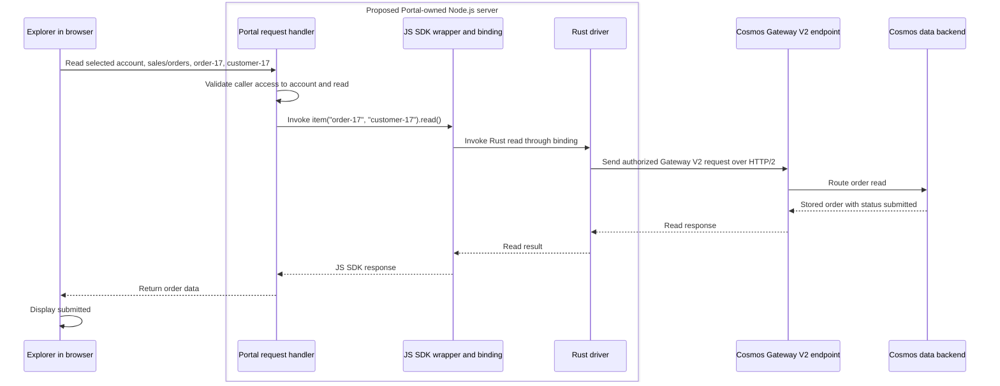

# Preserve Explorer's order-read experience while moving JS SDK work to Rust

## 1. What the customer needs

An Alpha Bank support engineer receives a question about order `order-17`.
They open Portal Data Explorer (**Explorer**) in the Azure portal and select
the order to inspect what the bank's application saved.

For this illustrative example, the order in the `sales` database's `orders`
container has these values. Orders are grouped by `customerId`, the
**partition key**. To read this one order, Explorer supplies both its `id`
and its `customerId`.

| Field | Stored value |
|---|---|
| `id` | `order-17` |
| `customerId` | `customer-17` |
| `status` | `submitted` |

The engineer needs to see that record, or a clear error if it cannot be read.
Seeing `submitted` tells them the saved order status. It does not by itself
prove that payment completed or that the order shipped. The engineer can use
the result to decide which part of the bank's order process to investigate
next.

**For this customer task alone, the existing read is sufficient.** The
engineering requirement added below is to perform that same read through
the **Rust driver**, a separately owned Rust library that performs Cosmos
operations. It is not a new customer action or a promised speedup.

**Decision, October 8, 2026:** pursue **Option B**, with the Rust-backed
JS SDK running on a Portal-owned Node.js service. Rust execution inside the
browser is outside this prototype.
The service's hosting details, binding validation, networking, and tenant
isolation still need design and verification. SSR is not a prerequisite.

The broader objective is to migrate all JS SDK APIs to the Rust driver.
This walkthrough uses one NoSQL item read as the first end-to-end
demonstration, not proof that the full migration is complete. Selecting
Node.js for Explorer does not establish support for other JS SDK customers
running in browsers.

The example data and successful results are illustrative, not recorded
test results. The selected Rust-backed flow has not been demonstrated
end to end here.

### What we will build and learn in the prototype

The prototype will let the engineer open the same `order-17`, but move
the JS SDK operation from the browser to a Portal-owned server. The server
will use **Node.js** to run JavaScript outside the browser and return the
order for Explorer to display.

1. **Establish today's result and timing.** Read the prepared order with
   the existing JS SDK and record the returned data and how long it takes.
2. **Connect the JS SDK to Rust.** Keep the public JavaScript read call,
   with adapter code connecting it to the Rust driver. **NAPI-RS is selected**
   for that binding; the prototype will validate the integration.
3. **Run the read through the server.** Explorer sends the selected account,
   database, container, order ID, and partition key to the Node.js handler.
   The handler calls the Rust-backed JS SDK and returns the order or an
   explicit error. The browser does not run the Rust driver.
4. **Check customer separation and access.** Verify that an allowed Alpha
   Bank engineer can still read the order under the intended firewall
   rules, while an unauthorized caller cannot. Add a second bank to check
   that its data stays separate and its reads are not overwhelmed by
   Alpha Bank's traffic.
5. **Measure the change fairly.** Compare the existing and Rust-backed
   JS SDKs on the same Node.js host, then compare today's browser experience
   with the complete server path. Include startup, read latency, completed
   work, CPU, and memory rather than assuming Rust makes the read faster.

**The first milestone is one correct, measured, end-to-end read**, with
evidence for access and customer separation. It is not the full API
migration or a production-ready proxy. The findings will guide the binding,
service design, and rollout across the remaining JS SDK APIs.

## 2. Before: the JS SDK reads the order inside the browser

Explorer calls the `@azure/cosmos` JavaScript SDK, called the **JS SDK** below.
It is a library running inside the browser, not a remote service. Explorer
manages sign-in; the JS SDK prepares the Cosmos requests, chooses destinations,
handles retries, and returns the result.

Alpha Bank's own application is the **customer app** that previously saved
the order. It does not perform this Explorer read. Explorer is the browser
application invoking the JS SDK on behalf of the support engineer.

**Input and invocation:** with an already configured and authorized JS SDK
client, the public call for this example is:

```javascript
const response = await client
  .database("sales")
  .container("orders")
  .item("order-17", "customer-17")
  .read();

const order = response.resource;
```

The client is configured for the selected Cosmos account before this call.
Executing `read()` requests this order; merely configuring the client does
not read it. This snippet illustrates the JS SDK API, not Explorer's exact source.
On success, Explorer displays the returned `order.status`, which is
`submitted` in this example. A failed read must be displayed as a failure,
not an empty order.

To send a request, the JS SDK calls **`fetch`**, the browser's network request
function. The browser manages the connection to the **Cosmos compute gateway**,
the service-side entry point for this existing read. Cosmos DB as a whole is
the **service backend**, not the Portal application or a Portal-owned server.

### Which HTTP version does today's read use?

**HTTP/1.1 and HTTP/2** are versions of the protocol carrying the request
and response. The current browser JS SDK delegates that connection to
`fetch`; it does not select a fixed HTTP version. The version used depends
on the connection the browser establishes with the endpoint or reuses.

**Not yet verified:** the HTTP version used by the deployed Explorer NoSQL
item read. HTTP/1.1 is a hypothesis to check, not a confirmed baseline.
Neither the current compute-gateway path nor the fact that the JS SDK is
JavaScript establishes the negotiated HTTP version.

To establish the baseline, perform this order read in Explorer and inspect
the actual Cosmos item-read request in the browser's Network panel, using
the Protocol column. Record its endpoint and displayed protocol, for example
`http/1.1` or `h2` (HTTP/2). Inspect the data request, not the Portal page
download or a preflight request. The observation establishes that tested
route, not every customer environment.

If today's read already uses HTTP/2, adding Rust is not what enables it.
The selected Rust path must still demonstrate the required Gateway V2
request format through the Node.js service.

**Before and after this action:** the database contains the submitted order
but Explorer has not displayed it yet. After the read, Explorer displays the
same record; the database is unchanged. The gateway routes the request and
the service backend supplies the stored data. This read does not update the
order, charge a payment, or send an email.

## 3. Selected Option B: Rust performs the read on Node.js

**Change one requirement:** allow the Rust-backed JS SDK to execute outside
the browser. This is the selected execution path for Explorer.
It avoids requiring the Rust driver itself to run within browser restrictions.

Instead of running the JS SDK locally, Explorer would ask a server to read
`order-17` and return the result. To run the Rust-backed JS SDK there, this
option proposes **Node.js**, which executes JavaScript outside the browser.
The Portal team would host that server for Explorer. The direction is
selected; deployment details and operational approvals remain open.

**Proposed input and action:** Explorer identifies the selected Cosmos
account and sends the same database `sales`, container `orders`, order ID
`order-17`, and customer ID `customer-17` to a **request handler** on that
Node.js server. The handler is application code the Portal team would
implement to receive the browser request and invoke the JS SDK.

The request handler and Rust-backed JS SDK would run inside this same
Node.js server. Calling the JS SDK is an in-process call, not another network
hop to a separate JS SDK service.

### Selected binding: NAPI-RS

The **JS wrapper** preserves the public JavaScript interface. It calls
**the binding**, adapter code we write using **NAPI-RS**, which invokes
the Rust driver inside the Node.js process. NAPI-RS is the selected binding
framework, not a ready-made Cosmos binding or a separate service.

For `order-17`, our binding would accept the read arguments, invoke the
Rust driver, and complete the JavaScript Promise with the result or an
error. The caller still uses `await ...read()`. Loading the native module
makes that code available; it does not itself request the order.

Before expanding beyond the first read, demonstrate that
the driver can complete asynchronous work without blocking Node.js from
handling other requests. Verify result and error conversion, cancellation,
client/runtime cleanup, credential callbacks, and native-package loading
on the supported Node.js versions, operating systems, and processor
architectures. Include an API-coverage check for queries, iterators, and
other operations beyond the first read. Measure the binding's cost rather
than assuming native execution is faster.

The driver must use **Gateway V2**, the Cosmos request path with its own
request format carried over HTTP/2. Its destination is the **Gateway V2
endpoint**, not necessarily the address of today's compute gateway.

The following diagram shows the **proposed successful read after access
checks pass**. The server box groups components running together; the
browser and Cosmos are outside it.



The driver uses its own HTTP client on the server rather than browser
`fetch`. It can enforce HTTP/2 or fail, refusing HTTP/1.1.
That control does not prove the connection will succeed.
The server-side Gateway V2 read still needs demonstration.
The browser no longer downloads or runs the Rust component.

Explorer must still be allowed to contact the new service. **Content Security
Policy (CSP)** controls which servers the page may contact. If that service
has a different origin (protocol, hostname, or port), **Cross-Origin Resource
Sharing (CORS)** controls whether the browser may expose its responses to
Explorer. Verify these permissions for the browser-to-service request;
moving Rust off the browser does not remove that check.

### Optional SSR: can the same server improve initial page loading?

Earlier discussion connected Node.js hosting to a possible page-loading
benefit. The decision now is to pursue B independently; the following
comparison explains an optional use of the same server, not a hosting gate.

Suppose the engineer opens Explorer directly to `order-17` in `sales/orders`,
with partition key `customer-17`. For this comparison, assume the account
and order are known at page load and the required authorization is available.
These are illustrative flows, not a trace of deployed Explorer.

#### Without SSR: the browser builds the order view

Start with the JS SDK running in the browser, as in Section 2.

| Stage | Who acts? | What happens? | What the engineer sees |
|---|---|---|---|
| 1. Request the page | Browser | Requests Explorer's page. | Waiting for the page. |
| 2. Return application files | Explorer's web host | Returns initial HTML and references to JavaScript and CSS. The HTML does not contain this order's status. | A page shell or loading indicator. |
| 3. Start Explorer | Browser | Downloads and executes the application JavaScript. | The application begins appearing. |
| 4. Read the order | Explorer and the browser JS SDK | Calls `.item("order-17", "customer-17").read()`. Cosmos returns the stored order. | Waiting for order data. |
| 5. Build the order view | Explorer's browser code | Uses the returned data to create the displayed order details. | `Status: submitted`. |

The dependency is **browser application starts -> requests data -> builds
the populated view**. This is **client-side rendering**: application
JavaScript builds the view in the browser.

Now move only the JS SDK operation to the Node.js server, as proposed in B.
At stage 4, Explorer calls the server's request handler, which invokes the
Rust-backed JS SDK and returns order data. Stage 5 stays in the browser.
**This is B without SSR:** a server reads the order, but the browser still
builds the order view.

#### With SSR: the server also prepares the initial order view

Keep B's server-side JS SDK execution and change one more step: the server
now prepares the order's HTML as part of the page response. This is
**server-side rendering (SSR)**. HTML describes the content the browser
will display.

| Stage | Who acts? | What happens? | What the engineer sees |
|---|---|---|---|
| 1. Request the page | Browser | Requests the order page, identifying the account and order. | Waiting for the page. |
| 2. Read the order | Node.js server and Rust-backed JS SDK | Executes the same item read. Cosmos returns `status: submitted`. | Still waiting for order content. |
| 3. Prepare the page | Node.js server | Produces HTML containing, for example, `<p>Status: submitted</p>`. | Still waiting. |
| 4. Display the response | Browser | Receives the HTML and displays the order details without waiting for Explorer's application JavaScript to build that view. | `Status: submitted`. |
| 5. Enable application interactions | Browser | Executes JavaScript that connects application behavior to the existing HTML, such as the Refresh button. | The order is visible and application controls become usable. |

The last step is called **hydration**. The order can be visible before
JavaScript-dependent controls work. This example uses a simple non-streaming
response: the server prepares the order content before sending the page.
Neither preparing HTML nor displaying it changes the stored order.

#### When the engineer clicks Refresh

For this proposed design, the browser sends a data request to the Node.js
handler. The handler invokes the Rust-backed JS SDK again and returns order
data. Browser code updates the existing view. That interaction does not
require a newly server-rendered page.

**The potential Portal benefit is earlier display of useful content on
initial load, not inherently faster Cosmos reads.** Server rendering takes
time too, and visible content is not necessarily usable controls. Compare
both time until the order appears and time until the page is usable.
If the order is selected only after Explorer opens, the initial page request
cannot include that as-yet-unknown order.

**JS SDK placement decides who reads the order; SSR decides who prepares
the initial page content.** If SSR measurably improves Explorer's loading
experience, the selected Node.js service could also support it.
**Unresolved:** SSR's feasibility and benefit for Explorer. If the existing
page-loading approach is sufficient, keep browser rendering and use B
without SSR.

For B we need a deployment plan, a packaged Node.js/Rust binding, a
server-side read handler, and a working connection to Cosmos. We must also
agree how the server reads the account without broadening the user's
permissions. This authorization decision is architectural because the
component performing the read has moved off the user's device.


## 4. A server-side read must not unexpectedly break customer firewalls

**Now change one customer condition:** Alpha Bank's administrator configures
the Azure Cosmos DB account's built-in IP firewall through its **Networking**
settings in Azure Portal. They select **Selected networks** and allow
`203.0.113.10`, the public address through which the engineer's browser
reaches Cosmos. Keep the same order and credentials.

This is a customer-controlled setting on the Cosmos DB account, not a change
to a separate corporate firewall. Alpha Bank decides whether its Cosmos DB
administrators or networking/security team manages that setting.
These addresses are illustrative, not real customer or Portal addresses.

| Read path | Source IP seen by Cosmos | Result if only `203.0.113.10` is allowed |
|---|---|---|
| Today's browser read | Browser network's public IP, `203.0.113.10` | IP check passes |
| B | Server's outbound IP, for example `198.51.100.20` | IP check fails unless that route is otherwise permitted |

### Proposed solution to investigate: preserve the browser-IP restriction

**Proposal from the discussion, not verified implementation:** make the
Portal server a trusted part of the service's access-checking design.
It would check the original browser
network's public IP against the target account's firewall policy, while
Cosmos would accept requests from that approved server through a specifically
authorized service path.

**Mutual TLS (mTLS)** uses certificates so the two ends of a connection can
authenticate each other. Here its proposed role is to authenticate the
Portal server to Cosmos. It does not preserve the browser's network source
IP or automatically place the server inside the service trust boundary.

```text
Proposed, not implemented:
Browser request reaches approved Portal server
    -> server obtains the original source IP from its trusted network entry point
    -> server checks that IP against the target account's firewall policy
    -> only an allowed request proceeds through the approved mTLS service path
    -> Cosmos still enforces the required data-access authorization
```

This needs a Cosmos-supported agreement about which server may perform the
check and how Cosmos recognizes that decision. Enabling mTLS alone is not
the agreement.

The service and security owners must establish trusted original-IP handling,
current account-policy enforcement, and denial when the check cannot be
completed. A browser-supplied IP header cannot be accepted as proof of the
caller's address. Private-endpoint and other network restrictions also need
separate treatment; this IP-check proposal does not establish reachability
or permission to bypass them.

| Same order and account policy | Proposed server decision | Intended result |
|---|---|---|
| Verified original IP is allowed `203.0.113.10` and credentials authorize the read | Permit the read through the approved service path | Explorer displays `submitted` |
| Verified original IP is disallowed `203.0.113.11` | Reject before forwarding the read | Explorer shows an access failure; no order data returned |
| Original IP cannot be trusted or current firewall policy cannot be checked | Deny rather than assume access | Explicit failure; no order data returned |

The order remains unchanged in all three cases. These are required outcomes
to test if the service design is approved, not results already observed.

**Intended result:** Alpha Bank keeps allowing the browser network's public
IP without adding Portal server IPs. An allowed engineer still sees the order;
a request from a disallowed address remains blocked. Credentials still need
to authorize the read. This is a proposed outcome, not an available capability
demonstrated by this effort.

## 5. Another bank uses the same service: tenant isolation

Alpha Bank's engineer still requests `order-17`. Now suppose Beta Bank
also uses Explorer and its request reaches the same Node.js service.
For this example, each bank is a **tenant**: a customer organization whose
requests and data must remain separate within a shared service. We are
not proposing to combine their Cosmos DB accounts or databases.

| Same service, different customer | Required action | Customer result |
|---|---|---|
| Both banks have an `order-17` | Establish the caller's authorized account and use the correct credentials and account-specific client state | Each engineer receives only their bank's order |
| Alpha Bank supplies Beta Bank's account identifier without permission | Reject the request rather than treating the supplied identifier as authorization | No Beta Bank order data is returned |
| Alpha Bank sends a burst of reads while Beta Bank sends one | Apply agreed per-tenant work and queue limits rather than letting Alpha Bank consume all capacity | Beta Bank's read stays within its agreed service target |
| An execution component serving Alpha Bank fails | Contain the failure to the agreed boundary | Other customers remain available within the agreed failure target |

The first two cases require **data and access isolation**: credentials,
cached results, and client state must not be mixed across customers or
callers with different permissions. The third requires **resource
isolation**, so one customer's heavy workload does not overwhelm others.
The last asks how much of the service can fail together.

Start by defining the boundary: does the service group work by customer
organization, Microsoft Entra tenant, or Cosmos DB account? These are not
interchangeable. Establish that identity from trusted authentication and
authorization, not an arbitrary tenant label sent by the browser.

**Open design choice:** shared execution with explicit limits, separate
processes or containers for customer groups, or dedicated capacity where
required. Separate JS SDK client objects alone do not demonstrate resource
or failure isolation. Do not choose one server per tenant without first
agreeing the protection, cost, and operational requirements.

The Portal team requested better isolation than its current proxies.
The specific shortcomings have not been established here. Review those
before choosing a design, then run the two-bank scenarios above. An
authorized single-customer read is not enough to establish isolation.

## 6. Measure the same read before claiming a performance improvement

The engineer still needs `order-17` displayed. We now ask two different
questions: **does the Rust-backed JS SDK perform better, and does Explorer
perform better after adding the Node.js service?** A faster JS SDK call
does not by itself answer the second question.

Use the Python migration's profiling approach from
`azure-sdk-for-python\sdk\cosmos\azure-cosmos\docs\V5\profiling` as the
methodology, not as a source of expected JavaScript timings. In particular,
`02-read-item-measurements.md` separates SDK-call timing from
scheduled-start timing; `03-read-item-cpu-profiling.md` and
`04-read-item-memory-profiling.md` investigate where resources go;
`06-phase-c-single-process-load.md`, `09-first-sdk-call-measurements.md`,
and `13-investigate-and-verify-improvements.md` cover load, startup, and
repeatable evidence. Adapt the harness to Node.js; do not reuse Python-only
profilers or transfer Python's numeric acceptance targets.

### First compare the implementations without changing the host

Both runs invoke the public read from Section 2 for the same prepared
order. Keep the account, region, item bytes, consistency, credentials,
timeout/retry settings, machine resources, Node.js version, requested rate,
and in-flight limit comparable. An in-flight limit caps the reads active
at once. Record any unavoidable differences, including gateway endpoint
and HTTP version; those differences prevent attributing the entire change
to Rust or NAPI-RS alone.

| Comparison | Baseline | Candidate | What it answers |
|---|---|---|---|
| JS SDK operation on Node.js | Existing JS SDK on the test host | Rust-backed JS SDK on the same host | How the complete JS SDK implementations compare without moving execution between browser and server |
| Explorer's selected path | Today's browser JS SDK read | Browser -> Node.js handler -> Rust-backed JS SDK | Whether the engineer sees the order sooner or later with B, including the extra service hop |
| Control if the proxy result needs explanation | Same Node.js handler using the existing JS SDK | Same handler using the Rust-backed JS SDK | Whether differences persist when the proxy route is held constant |

The control is an experiment, not an additional product architecture.
Start without SSR so page rendering does not change alongside the JS SDK.

### Time the stages the customer actually waits for

| Measurement | Start and stop | Interpretation |
|---|---|---|
| JS SDK call | Immediately before `.read()` until its Promise resolves or rejects | Includes local work and waiting inside the JS SDK |
| Scheduled read | Intended workload launch until completion | Also exposes late launches and waiting for an available slot |
| Explorer interaction | Selecting the order until its details or error appear | Includes browser work, network hops, server handling, and display |
| First-use readiness | Process startup through client creation and the first successful read | Separate from later reads using an initialized client |

For the same input, the result must still be Alpha Bank's `order-17` with
`status: submitted`. Verify returned content and failures before comparing
speed. Report failed reads separately; an error is not a fast successful
read. Retain startup samples and report first-use and steady-state results
separately rather than silently discarding slow initial calls.

Repeat baseline and candidate runs in alternating order without CPU or
memory profilers attached. Save per-operation measurements, build and
configuration identifiers, completed reads, failures, retries, throttling,
and requested versus achieved rate. Report mean, P50, P95, and P99 latency:
P99 describes the duration at or below which 99% of the measured calls fall.
Also report queue/slot waits and work never launched; the Python exercise
showed why an apparently good average does not establish acceptance.

**Results are not yet available:**

| Read-item result | Existing JS SDK on Node.js | Rust-backed JS SDK on Node.js |
|---|---|---|
| JS SDK-call P50 / P95 / P99 | Not measured | Not measured |
| Successful reads/s, errors, and scheduling waits | Not measured | Not measured |
| CPU use and process memory at the same achieved workload | Not measured | Not measured |
| First-use readiness and event-loop delay | Not measured | Not measured |

### Then locate costs and increase the work

If the comparison exposes a problem, profile JavaScript and native Rust
work separately while measuring the whole Node.js process. Check CPU,
JavaScript heap, native allocations, and total resident process memory.
Measure **event-loop delay**: how long Node.js postpones other ready
JavaScript work while these reads run.

For an instrumented read, distinguish wrapper work, binding conversion,
Rust execution and waiting, and delivery of the result back to JavaScript.
Use correlated per-read markers and compatible clocks. Time awaiting Rust
is not pure Rust CPU time, and JS SDK time minus reported service time is
not pure binding overhead. Do not subtract independent P99 values to
construct a single read's timeline.

Check instrumentation overhead with matching observations disabled,
enabled, then disabled again. Repeat any claimed improvement without the
profiler. Increase load within one process before testing multiple service
instances; include Alpha Bank's burst alongside Beta Bank's ordinary reads.
Also test repeated client creation/cleanup and longer runs for retained
memory. One short capture does not establish a leak or its absence.

**Acceptance still needs agreement:** JS SDK and Portal owners must set
latency, throughput, error, startup, memory, scheduling, and per-tenant
fairness limits before the runs. Preserve complete measurements separately
from the acceptance verdict. No JS/Rust speedup or benchmark execution is
claimed by this plan. After the read is understood, extend coverage across
the remaining JS SDK APIs and mixed workloads.

## 7. What changes, and what the customer should see

The selected path describes the intended design, not a completed implementation.

| Question | Current NoSQL read | Selected Node.js path |
|---|---|---|
| Who performs the JS SDK operation? | JS SDK in browser | Rust driver inside server JS SDK |
| Who opens the connection to Cosmos? | Browser | Node.js server's driver HTTP client |
| What Rust code does the browser download? | None | None |
| Is a Portal server needed for the read? | No | Yes; SSR is optional |
| Does the source IP change because of moving the read? | Baseline | Yes, requires a firewall design |
| Expected displayed record | `order-17`, `submitted` | Same record and expected behavior |
| Main proof still needed | Measured baseline | Binding, Gateway V2 read, authorization, firewall compatibility, tenant isolation, and measured performance |

## 8. Remaining work and concrete completion outcome

The execution decision is made: pursue Option B. First demonstrate the
same order read through the Node.js service, then expand to the full
JS SDK API migration. Choosing a path is not implementation approval
for unresolved authorization, networking, or isolation behavior.

| Decision or proof | Who needs to resolve it |
|---|---|
| Current NoSQL item-read endpoint and observed HTTP version recorded as the baseline | Portal and JS SDK owners |
| Node.js deployment, capacity, service ownership, and operational plan | Portal owners |
| NAPI-RS integration validated for async behavior, packaging, lifecycle, and full API needs | JS SDK and driver owners |
| Gateway V2 over HTTP/2 from the deployed Node.js service | Gateway and driver owners |
| Browser can contact the new service under applicable CSP and CORS rules | Portal hosting/security owners |
| B preserves the caller's data-access permissions | Portal identity and JS SDK owners |
| Server-side route preserves customer firewall intent without additional Portal-IP allowlisting | Cosmos service, network, and security owners |
| Tenant boundary, isolation design, and two-customer verification | Portal, identity, security, and performance owners |
| Comparable read-item measurements and agreed acceptance limits | JS SDK and Portal performance owners |
| API-by-API compatibility and rollout plan beyond the first read | JS SDK, driver, and Portal owners |
| Optional SSR benefit, evaluated separately from migration acceptance | Portal owners |

For Option B, the completed demonstration must return the selected
order through Gateway V2, preserve expected results and errors, and meet
agreed performance limits. Existing request settings, sign-in and renewal,
consistency, and cancellation remain compatibility requirements covered by
the [read-item guide](read_item.md), rather than separate
architecture choices.

**The customer outcome is deliberately unchanged:** the engineer opens the
same order, sees `submitted`, and continues investigating the customer's
question without a new sign-in procedure or an unexpected firewall failure.
The first engineering outcome is a proven Rust-backed JS SDK read on Node.js,
with measured performance and verified customer separation. The full outcome
requires migration and compatibility evidence across all JS SDK APIs.
Neither faster reads nor unchanged customer access should be claimed until
measured and demonstrated.
