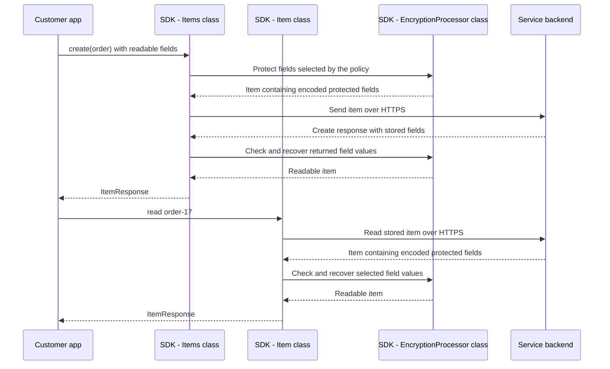

# Client-side encryption in the Cosmos JS SDK


## 1. Bite 1 of approximately 11 - How do we ask the SDK to encrypt `approvalLimit`?

Alpha Bank's customer app has this order:

```json
{
  "id": "order-17",
  "customerId": "customer-17",
  "approvalLimit": 42
}
```

The requirement is: **store the order in Cosmos DB without making
`approvalLimit` readable to someone who only has database access.** The
authorized customer app must still be able to recover `42`.

Calling `items.create(order)` on an ordinary client does **not** automatically
provide that protection. Before writing the order, the customer must configure
encryption.

### What does the SDK need?

| Required setup | Why it is necessary |
|---|---|
| Access to an encryption key | A **key** is secret material used to protect a value and recover it later. The SDK needs access to the appropriate key material; it cannot protect `42` merely because the field is sensitive. |
| A rule selecting the field and its key | The SDK does not infer which fields are sensitive. The customer explicitly selects `/approvalLimit` and identifies which key to use. These rules form the container's **client encryption policy**. |
| An encryption-enabled client | The customer configures the SDK client with the means to access the required keys. Creating a container policy alone is not the complete setup. |

For this example, the intended result of that configuration is:

```text
id             -> leave readable
customerId     -> leave readable
approvalLimit  -> encrypt using the configured key
```

**The customer chooses the protection; the SDK performs it.** We should
therefore explain the key setup and field-selection configuration before
tracing what happens during `items.create(order)`.

The customer-facing API for creating the container with its encryption
policy belongs after the key setup; Section 6 shows that API.

The first setup question is: **where should the key be controlled so that
database access alone does not also provide access to it?** That is where
the next bite begins.

The reference sections after the teaching bites retain the detailed
public-API, rollout, and evidence material.

The teaching sequence separates **Bite 10: how the PR protects
the type marker** from **Bite 11: deployment gotchas**. The latter covers
reader/writer compatibility, customer-visible failures, migration, and
configuration choices.

The **customer app** is Alpha Bank's Node.js application. The **SDK** is the
installed Cosmos JS package, whose code runs inside the customer app's
process. The **service backend** is the remote Cosmos DB service.

## 2. Bite 2 of approximately 11 - Why do we need Key Vault?

We established that the SDK needs key material to protect
`approvalLimit: 42`. But **having a key is not enough - we must control
who can use it.**

Consider this deliberately unsuitable design:

```text
Someone with database read access obtains:

    encrypted approvalLimit
    + the usable key needed to recover it

Result: they can recover 42.
```

That would defeat Alpha Bank's requirement. We need database access and
access to the necessary keys to be controlled separately. Azure Cosmos DB's
client-side encryption design supports this separation through
customer-controlled keys managed outside the database.

### What does Key Vault contribute?

**Azure Key Vault** is the separate Azure service used in this setup to
manage keys and control permission to use them. Permission to read Cosmos DB
items does not, by itself, grant permission to use the keys in Key Vault.
The customer must separately authorize the customer app to perform the
required key operations.

Alpha Bank therefore wants this arrangement:

| Actor in our example | Can read the stored order? | Has the required key access? | Intended outcome |
|---|---|---|---|
| Database reader | Yes | No | Can inspect the stored encrypted field, but cannot recover `42` |
| Authorized customer app | Yes | Yes | Its SDK can recover `42` |

This is the access separation we are configuring - not an automatic
guarantee that every database reader lacks key permissions. Alpha Bank
must assign those permissions accordingly.

### Does Key Vault encrypt each order field?

No. **The SDK protects the field inside the customer app's process.
Key Vault participates in protecting access to the key material needed
for that work.** These are separate responsibilities.

That separation leads to the next necessary concept: **the key protecting
the field and the key protecting that key have different jobs.**

### Reference: why HTTPS does not solve that need

**HTTPS** protects HTTP communication while it travels between the customer
app and the service backend. It encrypts the connection so someone observing
network traffic cannot simply read the order.

The service backend is the intended recipient of that connection. Without
additional field encryption, it receives the order's readable values after
the connection protection is removed.

**Encryption at rest** protects data on persistent storage. Cosmos DB
provides it automatically. The service backend can still process that
data and return readable values to an authorized database reader.

**Client-side encryption** changes what the SDK sends: it encrypts selected
values inside the customer app's process, before sending the item. The
service backend stores those encrypted values rather than their originals.
The SDK decrypts them after reading the item back.

| Protection | What it protects in this example | Does database read access alone return the original sensitive fields? |
|---|---|---|
| HTTPS | The connection carrying the order | Yes, without client-side field encryption |
| Encryption at rest | The stored data and backups | Yes, through an authorized service read, without client-side field encryption |
| Client-side encryption | The selected field values before they reach Cosmos DB | No; the reader also needs the client-side decryption capability and key access |

These protections work together. Client-side encryption does not replace
HTTPS or Cosmos DB's storage encryption.

The customer app still handles readable values before encryption and after
decryption. This feature does not protect against a compromised customer
app, logging those values, or someone who also has the required key access.

## 3. Bite 3 of approximately 11 - What must exist before the SDK can encrypt `42`?

### Start with the customer's API call

Alpha Bank wants to write this order and protect `approvalLimit`:

```ts
const order = {
  id: "order-17",
  customerId: "customer-17",
  approvalLimit: 42,
};

await container.items.create(order);
```

In the JS SDK, the item-creation API is **`container.items.create()`**,
rather than `create_item()`. This is a preview of the desired call, not
an additional operation to run before setup.

The desired transformation is:

```text
Customer app supplies:    approvalLimit: 42
Service backend stores:  approvalLimit: "<ASSEMBLED_FIELD>"
```

`<ASSEMBLED_FIELD>` is a placeholder for the complete protected field, not real
encryption output. All key labels in this bite are dummy values too.

**That API call does not automatically configure encryption.** Before it
runs, the customer must configure the client's key access and the container's
field-selection policy. This bite explains the key setup that those
configurations depend on.

### Before the write: the SDK needs a data key

A **data key** supplies the secret material the SDK uses to protect the
field. In our example:

```text
Original value:          42
Data key:                DATA-KEY-42
Resulting stored value:  <ASSEMBLED_FIELD>
```

During a separate setup operation, the customer app asks the SDK to create
the data key. The SDK generates `DATA-KEY-42` inside the customer app's
process.

But keeping it only in that process is insufficient. **After a restart,
the SDK must recover the same data key to read existing encrypted values.**
Generating a different key would not recover them.

So we need to preserve the data key, but not store its usable form where
a database reader can obtain it.

### Protect the data key before storing it

The customer creates or selects a separate key in Key Vault:
**`VAULT-KEY-42`**.

Its job is to encrypt the data key, not the order field. That makes it the
**wrapping key**. "Wrapping" simply means encrypting a key.

The responsibility transfer is:

```text
SDK -> Azure Key Vault:
    Encrypt DATA-KEY-42 using VAULT-KEY-42.

Azure Key Vault -> SDK:
    Here is ENCRYPTED-DATA-KEY-42.
```

The SDK makes this request through its Key Vault integration using the
customer app's authorized access.

We now have two distinct encrypted results:

```text
42           protected using DATA-KEY-42
    -> <ASSEMBLED_FIELD>

DATA-KEY-42   encrypted using VAULT-KEY-42
    -> ENCRYPTED-DATA-KEY-42
```

The SDK calls `ENCRYPTED-DATA-KEY-42` a **wrapped data key**. It is the
encrypted form of `DATA-KEY-42`, not another independently generated key.

### Store the encrypted data key and the instructions needed to recover it

The SDK must preserve both **what to decrypt** and **which Key Vault key
to use**.

Before sending anything to Cosmos DB, it prepares this information:

| Information | Our example | Purpose |
|---|---|---|
| Encrypted data key | `ENCRYPTED-DATA-KEY-42` | The protected key to recover later |
| Key service | Azure Key Vault | Identifies the key-service integration |
| Wrapping-key name label | `VAULT-KEY-42` | Names the configured wrapping key |
| Exact key identifier | The address below | Identifies the vault, key, and key version |
| Key-encryption procedure | `RSA_OAEP` | Identifies how the data key was encrypted |

An illustrative key identifier is:

```text
https://alpha-vault.vault.azure.net/keys/VAULT-KEY-42/VERSION-42
```

That address identifies a key; **it does not contain the key's secret
material or grant permission to use it.**

The SDK sends this information to the **Cosmos DB service backend** for
storage.

**Where?** A Cosmos DB database can contain more than application containers.
It also supports special database-level records for this feature, called
**client encryption key resources**. Think of one as a managed key record,
not an item in an application container.

```text
Database: sales
|
+-- Client encryption key record
|   +-- ENCRYPTED-DATA-KEY-42
|   +-- Key-service, key-identifier, and procedure information
|
+-- Container: orders
    +-- Item: order-17
        +-- approvalLimit: <ASSEMBLED_FIELD>
```

**Why store that record on the database side?** It gives another authorized
customer app process a persistent place to find the protected data key
associated with the data. The SDK need not depend on the original process
remaining alive.

The separation still holds: Cosmos DB stores the **encrypted** data key;
recovering it requires the separately authorized Key Vault operation.

### Now return to the item-creation call

Once key setup, client configuration, and the container policy are in place:

```text
Customer app -> SDK:
    Create the order containing approvalLimit: 42.

SDK, inside the customer app's process:
    Obtain DATA-KEY-42.
    Protect 42, producing <ASSEMBLED_FIELD>.

SDK -> Cosmos DB service backend:
    Send the order with approvalLimit: <ASSEMBLED_FIELD>.

Service backend:
    Store that order in the orders container.
```

If the SDK needs to recover the data key first, it reads the managed key
record from Cosmos DB, asks **Key Vault** to decrypt
`ENCRYPTED-DATA-KEY-42`, and receives `DATA-KEY-42`. Recovering the data
key this way is called **unwrapping**.

**Key setup preserves the ability to encrypt and decrypt. The item-creation
call uses that setup to protect the customer's field.**

### Is there a different data key for each document or unique field value?

**The SDK uses the data key selected for the field in the container's
encryption policy, not a new key for each document or each unique value.**

Suppose the customer creates a data key once, then configures:

```text
Field to encrypt:  /country
Data key to use:   DATA-KEY-42
```

The SDK uses that same key across documents:

| Document | Original `country` value | Data key used |
|---|---|---|
| Document 1 | `"India"` | `DATA-KEY-42` |
| Document 2 | `"Canada"` | `DATA-KEY-42` |
| Document 3 | `"India"` | `DATA-KEY-42` |
| Document 4 | `"Japan"` | `DATA-KEY-42` |

Writing `"Canada"` for the first time **does not trigger creation of a new
data key**. The SDK looks up the configuration for `/country`, not a key
associated with `"Canada"`.

The customer can also configure multiple fields to use the same data key,
or select different data keys for different fields. So it is neither
"one key per unique value" nor necessarily "one key for the entire customer."

**`DATA-KEY-42` is only a dummy label. Its name does not mean it belongs to
the value `42`; that same key can protect many different values.**

## 4. Bite 4 of approximately 11 - How does the customer connect the SDK to Key Vault?

We know what should happen: the SDK asks Key Vault to protect or recover
`DATA-KEY-42` using `VAULT-KEY-42`.

But **Key Vault must know who is making that request and whether that
caller is allowed to use the key.** Before creating the data key, the
customer must establish that access.

### The customer administrator establishes permission

An **application identity** represents the customer app when it accesses
Azure services. **Authentication** establishes who the caller is;
permissions determine what that caller is allowed to do.

Key Vault uses **Microsoft Entra ID**, formerly called Azure AD or AAD,
for authentication. This is the familiar Azure identity system, not a
new authentication mechanism specific to encryption.

The customer administrator:

1. Creates or selects `VAULT-KEY-42` in Key Vault.
2. Chooses the application identity the customer app will use.
3. Grants that identity permission to perform the required key operations,
   including wrapping and unwrapping.

This is separate from granting access to Cosmos DB. **A Cosmos account
key does not grant access to Key Vault.**

The administrator also records the versioned key identifier:

```text
https://alpha-vault.vault.azure.net/keys/VAULT-KEY-42/VERSION-42
```

We will supply this identifier when creating the data key. It is not
passed into the client configuration below.

### The customer app gives the SDK a way to use that permission

Two objects connect the SDK to Key Vault:

| Object | What it does |
|---|---|
| Credential | Lets the SDK authenticate using the identity configured for the customer app |
| Key resolver | Implements the calls that ask Key Vault to wrap or unwrap a data key, using that credential |

The SDK provides `AzureKeyVaultEncryptionKeyResolver` for the second object.
The example uses `DefaultAzureCredential` from `@azure/identity` for the
first. It obtains authentication through the configured application
environment. Constructing it **does not create an identity or grant
permissions**; the administrator's setup must already provide those.

Here, `cosmosEndpoint` and `cosmosAccountKey` come from the customer app's
existing secure Cosmos connection configuration. The former is the Cosmos
service address; the latter authorizes Cosmos requests.

```ts
import { DefaultAzureCredential } from "@azure/identity";
import { AzureKeyVaultEncryptionKeyResolver, CosmosClient } from "@azure/cosmos";

const credential = new DefaultAzureCredential();
const keyResolver = new AzureKeyVaultEncryptionKeyResolver(credential);

const client = new CosmosClient({
  endpoint: cosmosEndpoint,
  key: cosmosAccountKey,
  clientEncryptionOptions: {
    keyEncryptionKeyResolver: keyResolver,
  },
});
```

### Separate the two service connections from the encryption keys

The example uses two service connections, with different authentication
choices:

| Connection | Authentication used in this example | Configuration |
|---|---|---|
| SDK to Cosmos DB service backend | Cosmos account-key authentication | `key: cosmosAccountKey` |
| SDK's key resolver to Key Vault | Microsoft Entra ID authentication | `credential` supplied to the resolver |

The word **key** also appears in the encryption setup, but those keys have
different jobs:

| Name from our example | Purpose |
|---|---|
| `cosmosAccountKey` | Authorizes requests to Cosmos DB |
| `DATA-KEY-42` | Supplies the material for protecting field values |
| `VAULT-KEY-42` | Protects the data key |

The last two are **encryption keys, not credentials used to sign in to
Key Vault**. The customer app authenticates through Entra ID, and Key Vault
checks whether that identity may use `VAULT-KEY-42`. The customer does not
copy the Key Vault key's private material into `CosmosClient`.

### Could both service connections use Entra ID?

Yes. For the Cosmos connection, the JS SDK accepts an identity credential
through `aadCredentials` instead of `key`. The same application identity
can be granted access to both services, but **permission must be configured
separately for each service and the required operations**.

Cosmos access does not automatically provide Key Vault access, and Key
Vault access does not automatically provide Cosmos access. This walkthrough
keeps the account-key configuration shown above for Cosmos requests.

### What does this configuration change?

It tells the Cosmos SDK how to perform future key operations:

```text
Cosmos SDK needs a data key wrapped or unwrapped
    -> calls the configured key resolver
    -> resolver calls Azure Key Vault using the credential
    -> Key Vault authenticates the caller and checks permission
    -> if authorized, Key Vault performs the requested operation
    -> resolver returns the result to the Cosmos SDK
```

The customer app supplies the configuration. The SDK and its resolver
perform the key-service calls; the customer does not manually call Key
Vault for each order.

**At this point, the client is encryption-capable, but `DATA-KEY-42` has
not been created and `/approvalLimit` has not been selected for encryption.**

The next setup step is the customer-facing API that creates the data key,
identifies `VAULT-KEY-42`, and stores the encrypted data-key record in `sales`.

## 5. Bite 5 of approximately 11 - Which API creates the data key?

Bite 4 connected the SDK to Key Vault. Now the customer app can ask the SDK
to **generate `DATA-KEY-42`, protect it using `VAULT-KEY-42`, and store the
encrypted data-key record in `sales`.**

The customer-facing API is `database.createClientEncryptionKey(...)`.

### Give the stored record a name

The SDK will store a client encryption key record, the database-level
record introduced in Bite 3. The customer must give that record an
identifier so the container policy can refer to it later.

We will use **`orders-key`**:

```text
orders-key
    = identifier of the managed record in Cosmos DB

DATA-KEY-42
    = dummy label for the secret material generated by the SDK
```

**The customer supplies `orders-key`; the SDK generates the data key.**
Naming the record does not supply the secret material.

### Tell the SDK which Key Vault key to use

The API also needs **key-wrap metadata**: configuration describing where
the wrapping key is and how to use it.

| Configuration property | What we supply | Meaning |
|---|---|---|
| `type` | `EncryptionKeyResolverName.AzureKeyVault` | Use the Azure Key Vault integration |
| `name` | `"VAULT-KEY-42"` | A label identifying the configured wrapping key |
| `value` | The versioned Key Vault address from Bite 4 | Locates the exact vault, key, and key version |
| `algorithm` | `KeyEncryptionAlgorithm.RSA_OAEP` | Selects the procedure used to encrypt the data key |

An **algorithm** is a procedure for performing an operation. This API
distinguishes the algorithm for **protecting field values** from the
algorithm for **encrypting the data key**.

### Make the setup call

Use the encryption-enabled `client` from Bite 4. Assume the `sales` database
already exists; `client.database("sales")` obtains a handle for it, rather
than creating it.

```ts
import {
  EncryptionAlgorithm,
  EncryptionKeyResolverName,
  KeyEncryptionAlgorithm,
} from "@azure/cosmos";

const database = client.database("sales");

await database.createClientEncryptionKey(
  "orders-key",
  EncryptionAlgorithm.AEAD_AES_256_CBC_HMAC_SHA256,
  {
    type: EncryptionKeyResolverName.AzureKeyVault,
    name: "VAULT-KEY-42",
    value:
      "https://alpha-vault.vault.azure.net/keys/VAULT-KEY-42/VERSION-42",
    algorithm: KeyEncryptionAlgorithm.RSA_OAEP,
  },
);
```

The second argument selects the SDK's supported field-protection algorithm.
The `algorithm` inside the configuration object selects the **data-key
wrapping** procedure.

The Key Vault address above is illustrative; a real application supplies
its actual versioned key identifier.

### What happens during this call?

```text
Customer app -> SDK:
    Create the key record named orders-key,
    using the supplied wrapping-key configuration.

SDK, inside the customer app's process:
    Generate DATA-KEY-42.

SDK's configured resolver -> Azure Key Vault:
    Encrypt DATA-KEY-42 using the identified VAULT-KEY-42.

Azure Key Vault -> SDK:
    Return ENCRYPTED-DATA-KEY-42.

SDK -> Cosmos DB service backend:
    Create the orders-key record in sales,
    containing ENCRYPTED-DATA-KEY-42,
    the field-protection algorithm,
    and the supplied wrapping-key configuration.
```

The customer performs this setup **for each data key they choose to create,
not for every document or unique field value**.

**This call creates the key record. It does not write an order or select
`/approvalLimit` for encryption.** Next, we can create the container policy
that connects `/approvalLimit` to `orders-key`.

### Reference: where the feature lives and how to run the examples

The encryption must happen before the order leaves the customer app.
In JavaScript, that functionality is included in **`@azure/cosmos`**.
There is no separate Cosmos encryption package to install. The SDK exposes
the encryption configuration and helper APIs from the same package as
`CosmosClient`.

The feature described here runs in Node.js. The inspected browser
implementation explicitly rejects client-side encryption operations;
browser support for ordinary Cosmos operations does not imply support
for this encryption feature.

Apart from the illustrative calls in Bites 3 and 8, the TypeScript fragments in this
guide belong to one application setup. Keep imports at module scope and
run the operations using `await` inside an asynchronous function. The
database `sales` is assumed to exist.

## 6. Bite 6 of approximately 11 - How does the customer select `/approvalLimit` for encryption?

The `orders-key` record now exists in `sales`. But it does not tell the
SDK which fields to encrypt.

The customer must connect the field to that key through the container's
**client encryption policy**:

```text
Field: /approvalLimit
    -> use the key identified by orders-key
    -> SDK obtains DATA-KEY-42 through that key record
```

The customer-facing API is **`database.containers.create()`**. The customer
supplies the policy as part of creating the container, not as an option
on each item write.

### Choose how the field should be encrypted

For this example, the customer app needs to write and read `approvalLimit`,
but does not need to search for orders by that value.

We select **randomized encryption**: encrypting the same value repeatedly
can produce different encrypted representations.

**This does not mean generating a different data key for every write.**
The SDK reuses the selected data key; the encryption operation introduces
the variation.

Randomized encryption does not support ordinary equality filtering on
the encrypted field, so this choice must match how the customer app uses it.

### Describe the field-selection rule

The policy contains an `includedPaths` list. Each entry identifies a field
and its encryption settings:

| Property | Our choice | Meaning |
|---|---|---|
| `path` | `"/approvalLimit"` | Select the order's top-level `approvalLimit` field |
| `clientEncryptionKeyId` | `"orders-key"` | Refer to the key record created in Bite 5, not the secret key itself |
| `encryptionType` | `EncryptionType.RANDOMIZED` | Use randomized encryption |
| `encryptionAlgorithm` | `EncryptionAlgorithm.AEAD_AES_256_CBC_HMAC_SHA256` | Use the supported field-protection procedure selected in Bite 5 |

The policy also has a **`policyFormatVersion`**, which identifies the
version of the policy definition. This example uses supported version `2`;
it is not a count of keys or encrypted fields.

### Create the container with that policy

Use `database` and `EncryptionAlgorithm` from Bite 5.

The container also needs a **partition key**: a field Cosmos DB uses to
group and locate items. We choose `/customerId` and leave it unencrypted.

```ts
import { EncryptionType } from "@azure/cosmos";

const { container } = await database.containers.create({
  id: "orders",
  partitionKey: {
    paths: ["/customerId"],
  },
  clientEncryptionPolicy: {
    policyFormatVersion: 2,
    includedPaths: [
      {
        path: "/approvalLimit",
        clientEncryptionKeyId: "orders-key",
        encryptionType: EncryptionType.RANDOMIZED,
        encryptionAlgorithm: EncryptionAlgorithm.AEAD_AES_256_CBC_HMAC_SHA256,
      },
    ],
  },
});
```

This creates a **new** container. The encryption policy is fixed at
container creation; calling `createIfNotExists()` does not replace the
policy of an existing container.

### Who stores the policy, and who applies it?

```text
Customer app -> SDK:
    Create orders with this encryption policy.

SDK -> Cosmos DB service backend:
    Send the container definition, including the policy.

Service backend:
    Create the container and store its policy.

During subsequent item operations, SDK:
    Use that policy to identify the fields and keys.
    Perform field encryption inside the customer app's process.
```

**Storing the policy in Cosmos DB does not make the service backend perform
the encryption.** The SDK applies it before sending the item.

The customer app can now make the original write:

```ts
const order = {
  id: "order-17",
  customerId: "customer-17",
  approvalLimit: 42,
};

await container.items.create(order);
```

The intended stored result is:

```json
{
  "id": "order-17",
  "customerId": "customer-17",
  "approvalLimit": "<ASSEMBLED_FIELD>"
}
```

`<ASSEMBLED_FIELD>` remains a dummy illustration. The next bite follows
how the SDK constructs the actual protected field, the groundwork needed
to understand the PR's type-marker issue.

### Reference: policy scope

Policy versions 1 and 2 are supported; version 2 also permits encrypted
ID and partition-key paths. This example leaves those fields unencrypted.

Policy paths select top-level properties. When a selected property contains
an object or array, the inspected SDK walks its values rather than hiding
the whole structure in one opaque value. Field names, structure, unselected
fields, and nulls are not all concealed by this feature.

## 7. Bite 7 of approximately 11 - Why does the SDK need a type marker?

The customer app has called `container.items.create(order)` with:

```json
{
  "id": "order-17",
  "customerId": "customer-17",
  "approvalLimit": 42
}
```

The SDK knows that `/approvalLimit` must be encrypted using the data key
associated with `orders-key`.

But before encrypting `42`, it must solve another problem: **how will it
reconstruct the original kind of value after reading and decrypting it?**

### Encryption works on bytes, not directly on JavaScript values

**Bytes** are units of data processed by the encryption operation.

The SDK first performs **serialization**: converting the customer app's
value into a sequence of bytes.

Using a dummy label:

```text
Inside the SDK:

    JavaScript value: 42
        -> serialize as a whole number
        -> NUMBER-BYTES-42
```

`NUMBER-BYTES-42` represents the bytes, not the literal text `"42"`.

The reverse operation is **deserialization**: interpreting recovered bytes
to reconstruct a value for the customer app.

### The SDK must remember which interpretation to use

These customer values are not interchangeable:

| Customer value | Meaning | Representation selected by the SDK |
|---|---|---|
| `42` | A whole number | Integer representation |
| `"42"` | Text containing two characters | String representation |
| `42.5` | A number with a fractional part | Floating-point representation |

**Floating-point** is a representation that supports fractional numbers.
JavaScript represents both `42` and `42.5` as `number`, but the SDK selects
different serialized representations for these examples.

After decryption, the SDK receives bytes, not the original JavaScript
value with its interpretation attached.

It therefore records a **type marker**: a small identifier telling the
reader which deserialization procedure to use.

For our value:

```text
Original value:       42
Serialized bytes:    NUMBER-BYTES-42
Type marker:         INTEGER
```

`INTEGER` is a readable dummy label. The actual marker is a single byte.

### Where does that marker go?

The SDK includes the marker in the **same stored field** as the protected
data. It is not a separate property on the order and is not part of the
container policy.

Our earlier placeholder therefore stands for more than encrypted number
bytes:

```text
approvalLimit: <ASSEMBLED_FIELD>

Expanded conceptual contents:
    type marker: INTEGER
    protected data representing NUMBER-BYTES-42
    other information needed to read the protected field
```

This is an incomplete view of the contents, not the actual storage
encoding. We will introduce the remaining pieces when explaining why
they are needed.

### What uses the marker on a read?

The **SDK**, not the service backend:

```text
Service backend -> SDK:
    Return the stored protected field.

SDK:
    Recover NUMBER-BYTES-42 through decryption.
    Use the INTEGER marker to select integer deserialization.
    Interpret NUMBER-BYTES-42 as the number 42.

SDK -> Customer app:
    Return approvalLimit: 42.
```

**The encrypted bytes preserve the data; the type marker tells the SDK
how to interpret that data.** This distinction is essential to understanding
the PR, but first, the next bite explains how the SDK encrypts those bytes
and creates a check for unauthorized changes.

### Reference: obtain usable key material before protecting the field

The SDK can **cache** settings and usable keys: retain them in memory for
reuse. If they are not already cached, the SDK
reads the container policy and the `orders-key` resource from Cosmos DB.
The resolver requests unwrapping of the stored data key using the
application's Key Vault access.

The SDK receives the usable data key in its process. Responsibility then
returns to the SDK's local encryption code: Key Vault does not receive
`approvalLimit` to encrypt or decrypt it.

The first operation that needs encryption can initialize this state.
The customer app can instead call `container.initializeEncryption()` before
processing its first order. Settings and key material can be cached for
reuse, so unwrapping is not necessarily repeated for every field or item.

## 8. Bite 8 of approximately 11 - What does "encrypt using the data key" actually involve?

**`DATA-KEY-42` supplies the secret material for field protection, but the
SDK does not pass it directly into every cryptographic operation.**

The earlier bites described the customer setup. We now make the SDK's
internal step explicit.

Alongside encryption, the SDK needs a way to detect changes. In this guide,
a **fingerprint** means a value calculated from specific bytes and a secret
key. The SDK's technical term for this value is **authentication tag**.

This is not a plain hash of the entire document. A plain hash depends only
on the input bytes, so anyone can recompute it. Our fingerprint also requires
the secret key and covers **only the bytes included in its calculation**.
It does not automatically protect every piece stored beside it.

### Which keys exist, and where do they come from?

We already introduced:

| Key | Purpose |
|---|---|
| `VAULT-KEY-42` | Encrypts the data key so its encrypted form can be stored in Cosmos DB |
| `DATA-KEY-42` | Supplies the secret material the SDK needs to protect field values |

Inside the customer app's process, the SDK **derives additional keys from
`DATA-KEY-42`**. "Derives" means calculates reproducibly: the same data
key and the same calculation produce the same result.

For the randomized field encryption we are following, the two derived
keys used below are:

```text
DATA-KEY-42
    |
    +-- SDK's encryption-key calculation
    |       -> ENCRYPTION-KEY-42
    |
    +-- SDK's fingerprint-key calculation
            -> FINGERPRINT-KEY-42
```

**`ENCRYPTION-KEY-42`** encrypts and decrypts the field's bytes.
**`FINGERPRINT-KEY-42`** calculates and verifies the fingerprint of the
protected bytes.

**Yes, these are additional keys inside the SDK.** But the customer does
not create separate Key Vault entries or database records for them. The
SDK separates the two operations while allowing both keys to be recovered
from the one persisted data key.

They are not newly generated random keys for each document. All key and
output labels in this bite remain dummy illustrations, not real secret
material or valid encryption outputs.

### Encrypt `approvalLimit: 42` during the item write

We are following the customer's call from Bite 6:

```ts
await container.items.create({
  id: "order-17",
  customerId: "customer-17",
  approvalLimit: 42,
});
```

This repeats the call for explanation, not as an additional operation
to execute. Bite 7 established that the SDK converts `42` into
`NUMBER-BYTES-42`.

Because the policy selects randomized encryption, the SDK also generates
a fresh **initialization vector**, or **IV**: an additional input that
makes repeated encryption of the same value produce different encrypted
results.

For this particular field encryption, call it `IV-42`.

```text
Inside the SDK:

    NUMBER-BYTES-42
    + ENCRYPTION-KEY-42
    + IV-42
        -> encryption
        -> CIPHERTEXT-42
```

**Ciphertext** means the encrypted bytes. The unencrypted input bytes are
called **plaintext**.

"Repeated encryption" means, for example, creating another order whose
`approvalLimit` is also `42`. The SDK reuses the same derived encryption
key but generates another IV for that field encryption.

The IV must be stored because decryption needs it again. **It is not a
secret key.**

### Calculate a fingerprint before sending the protected field

Hiding `42` does not establish that someone has not subsequently changed
the stored bytes.

The SDK calculates the fingerprint from the bytes being protected and
**`FINGERPRINT-KEY-42`, the key derived above**.

This checks the protected data. It is not Entra ID authentication or
permission to access Cosmos DB.

The calculation is named **HMAC-SHA256**. For the existing encrypted-field
format, its input is:

```text
Format version 1
    | IV-42
    | CIPHERTEXT-42
    | version-length byte 1
```

The two occurrences of `1` mean different things. They need separate
explanations.

#### The first `1` means "use encrypted-value format version 1"

The SDK stores several pieces together: the type marker, version number,
fingerprint, IV, and encrypted bytes.

A **format** defines how those pieces are arranged and processed. The
version number labels that format so the SDK can recognize the
representation it is reading.

For our example:

```text
Version number = 1
Meaning: this value uses encrypted-value format version 1.
```

This is not the container's encryption-policy version.

#### The final `1` means "the version number takes up one byte"

When calculating the fingerprint, the SDK includes an additional,
hard-coded value:

```text
Version-field length = 1
Meaning: one byte is used to represent the version number.
```

**The version number and its storage size are different things.** A version
number of `2` can also fit in one byte; its size would still be `1`.

Here is the existing fingerprint calculation with the two meanings labeled:

```text
Bytes used to calculate the fingerprint:

    [version number: 1]
    + [IV-42]
    + [CIPHERTEXT-42]
    + [version-field length: 1]

Secret key used for that calculation:
    FINGERPRINT-KEY-42
```

**That final length byte is an input to the fingerprint calculation. It is
not an extra byte appended to the stored field.** The SDK supplies the same fixed
value when calculating the fingerprint during a write and recomputing it
during a read.

The SDK includes the format's version number when calculating the
fingerprint. It also includes a fixed value indicating that the
version number occupies one byte. The SDK supplies both automatically;
the customer does not configure them.

These details describe the fingerprint's exact calculation, not additional
keys, the length of `42`, or the length of the encrypted value.

#### Calculate and store the fingerprint

```text
SDK calculates:

    HMAC-SHA256(
        key: FINGERPRINT-KEY-42,
        data: the sequence above
    )

Result: FINGERPRINT-42
```

`FINGERPRINT-42` is our dummy value for that result. The SDK includes it in
the protected field sent to Cosmos DB.

**The type marker `INTEGER` is not included in this existing calculation.**

### On a read, calculate the fingerprint again

The service backend returns the stored field, including `FINGERPRINT-42`,
the IV, and the ciphertext.

The SDK obtains `DATA-KEY-42` if necessary and derives the same
`FINGERPRINT-KEY-42`. It then repeats the calculation using the bytes
returned by the service backend.

There are now two fingerprint values:

| Fingerprint | Where it came from |
|---|---|
| Stored fingerprint | Calculated by the SDK during the write, then stored in Cosmos DB |
| Recomputed fingerprint | Calculated by the SDK now, during the read, from the returned bytes |

If the protected bytes are unchanged:

```text
Stored fingerprint:       FINGERPRINT-42
Recomputed fingerprint:   FINGERPRINT-42
Result:                   Match - proceed to decryption.
```

If the protected bytes were changed without a valid replacement fingerprint,
the comparison fails and the SDK rejects the field **before decrypting it**.

The SDK, not Key Vault or the service backend, performs this calculation
and comparison. The check protects the bytes included in its calculation;
it does not automatically protect everything stored alongside them.

## 9. Bite 9 of approximately 11 - How can the value change even when the fingerprint check passes?

We now have enough pieces to understand the reported problem: **the SDK
protects the encrypted bytes, but the existing format leaves out information
that determines how those bytes become a customer-visible value.**

### Assemble the complete stored field

For `approvalLimit: 42`, the SDK puts these pieces together:

```text
INTEGER | 1 | FINGERPRINT-42 | IV-42 | CIPHERTEXT-42
```

| Piece | Dummy value | Why it is present |
|---|---|---|
| Type marker | `INTEGER` | Selects how decrypted bytes are interpreted |
| Encrypted-value format version | `1` | Identifies the package format |
| Fingerprint | `FINGERPRINT-42` | Lets the SDK check the bytes included in its calculation |
| IV | `IV-42` | Supplies the IV used by the encryption operation |
| Ciphertext | `CIPHERTEXT-42` | Contains the encrypted serialized value |

The PR calls this existing version-1 representation the **legacy format**.
That means an older encrypted representation, not an unencrypted field
or a different kind of database.

The version-length byte discussed in Bite 8 is **not another stored
piece**; the SDK supplies it when calculating the fingerprint.

The labels and separators above are an expanded logical view, not the
actual byte encoding. The SDK converts the complete bundle to **Base64**,
a reversible way to represent bytes as text. Base64 is not encryption;
encoding or decoding it requires no secret key.

```text
Complete bundle:
    INTEGER | 1 | FINGERPRINT-42 | IV-42 | CIPHERTEXT-42

Dummy label for the complete Base64 string:
    <ASSEMBLED_FIELD>
```

The item sent to the service backend looks like this:

```json
{
  "id": "order-17",
  "customerId": "customer-17",
  "approvalLimit": "<ASSEMBLED_FIELD>"
}
```

`<ASSEMBLED_FIELD>` is a placeholder, not literal valid Base64 or
ciphertext. It stands for the complete stored string, not just the
encrypted number bytes.
**The type marker, fingerprint, IV, and ciphertext are all inside each
encrypted field's string.** There are no separate JSON properties for them. The
container policy and wrapped data-key resource are stored separately.

### What access does the marker-change scenario assume?

**Not necessarily unauthorized database access. The important distinction
is database write access versus access to the encryption keys.** Those
permissions are deliberately separate in client-side encryption.

The person must be able to obtain the stored encrypted field and overwrite
it. They might have legitimately granted database permissions, or they
might have obtained someone else's credentials. **Read-only access is
insufficient to make this modification.**

The issue is that a database writer **without the encryption keys** can
change the marker while leaving the bytes covered by the fingerprint untouched.
"Unauthorized" here can mean not authorized to change the protected value,
even though the database accepts that person's write request.

### Being inside Base64 does not make the marker encrypted

Base64 conversion does not require a secret key. Anyone who can read the
stored string can decode it and recover the sequence of bytes.

That does **not** reveal the original `42`: `CIPHERTEXT-42` is still
encrypted.

But the marker is a separate byte placed before the encryption package.
It is visible after Base64 decoding.

The phrase **outer type marker** refers to that position outside the
encryption routine's package. It does not mean outside the Base64 text,
outside the field, or outside the stored item.

Someone who can read and overwrite the stored field could therefore
make this change:

```text
Before:
    INTEGER | 1 | FINGERPRINT-42 | IV-42 | CIPHERTEXT-42

After:
    FLOATING-POINT | 1 | FINGERPRINT-42 | IV-42 | CIPHERTEXT-42
```

The labels are illustrative; the actual modification changes the marker
byte. The person then converts the modified sequence back to Base64 and
writes that string into `approvalLimit`.

**They have changed the interpretation instruction, not decrypted or
re-encrypted the number.** No data-key or Key Vault access is needed for
that modification.

### Why does the fingerprint check still pass?

During the next read, the SDK recomputes the fingerprint using the inputs
from Bite 8:

```text
Version number:        unchanged
IV:                    unchanged
Ciphertext:            unchanged
Version-field length:  unchanged
Fingerprint key:       unchanged
```

The modified type marker is **not an input to that calculation**.

Therefore:

```text
Stored fingerprint:       FINGERPRINT-42
Recomputed fingerprint:   FINGERPRINT-42
Result:                   Match
```

The check has not malfunctioned. It correctly verifies the bytes it was
designed to cover. **The problem is that those bytes do not include the
type marker.**

### Where does the returned value change?

After the fingerprints match, the SDK decrypts the unchanged ciphertext:

```text
CIPHERTEXT-42
    -> decryption
    -> NUMBER-BYTES-42
```

So far, the original bytes have been recovered correctly.

The difference occurs during **deserialization**, when the SDK interprets
those bytes:

```text
Before the modification:
    INTEGER marker
        -> interpret NUMBER-BYTES-42 as a whole number
        -> return 42

After the modification:
    FLOATING-POINT marker
        -> interpret the same bytes using floating-point rules
        -> return a different number
```

The service backend returned the modified field. The SDK accepted its
fingerprint and then used the unprotected marker to reconstruct the value
returned to the customer app.

**The central issue is not that someone discovered the key or broke
encryption. It is that an unchecked instruction can change the meaning
of correctly decrypted bytes.** This is an **integrity problem**: changed
data can pass the check and alter the returned value.

The inspected PR tests include an integer-to-floating-point example for
`42`. Those assertions support the scenario; they were not executed as
part of this documentation update.

### How should a genuine update happen?

**Through the encryption-enabled SDK, with the necessary database
permissions and key access, not by manually editing the stored encrypted
string.** The SDK's update path encrypts the supplied readable value
according to the container policy.

For example, to change `approvalLimit` from `42` to `100`, the customer app
can use a **patch**, which updates the selected field without replacing
the entire item:

```ts
await container.item("order-17", "customer-17").patch([
  {
    op: "replace",
    path: "/approvalLimit",
    value: 100,
  },
]);
```

The inspected JS SDK supports this replacement operation on an encrypted
field. This is an optional legitimate-update example, separate from the
marker-change scenario.

The resulting flow is:

```text
Customer app -> SDK:
    Change approvalLimit to 100.

SDK:
    Select the configured orders-key data key.
    Serialize 100.
    Encrypt it with a fresh IV for randomized encryption.
    Calculate a new fingerprint.
    Assemble the complete new protected field.

SDK -> Service backend:
    Replace approvalLimit with the newly assembled <ASSEMBLED_FIELD>.
```

Here, `<ASSEMBLED_FIELD>` represents the complete encoded field for `100`,
not the bytes previously stored for `42`. **The SDK reuses the configured
data key; it creates new encrypted data and a corresponding valid fingerprint.**
It does not retain the old fingerprint while changing the protected bytes.

The customer app must still decide whether its user is allowed to make
that business change. The SDK applies encryption; its patch implementation
does not decide whether raising an approval limit is appropriate.

| Responsibility | Question |
|---|---|
| Customer app's business rules | Is this user allowed to change the approval limit to `100`? |
| Service backend's request authorization | Is this caller allowed to perform the database update? |
| SDK's fingerprint check | Does the stored fingerprint match the one recomputed from the bytes covered by this format? |

The next bite examines how the PR includes the type marker in the
fingerprint calculation.

## 10. Bite 10 of approximately 11 - How does the PR protect the type marker?

The required outcome is:

> If someone changes `INTEGER` to `FLOATING-POINT`, the SDK must reject
> the field, not return a different number.

The PR achieves this by **including the type marker in the fingerprint
calculation and verifying that fingerprint before interpreting the
decrypted bytes**.

This bite follows the new-format behavior. Configuration and deployment
come next.

### 1. Change what the fingerprint covers

The existing format calculates its fingerprint from:

```text
[version: 1]
+ [IV-42]
+ [CIPHERTEXT-42]
+ [version-field length: 1]
```

The proposed format calculates it from:

```text
[version: 2]
+ [type marker: INTEGER]       <- now included
+ [IV-42]
+ [CIPHERTEXT-42]
+ [version-field length: 1]
```

Both calculations use the secret `FINGERPRINT-KEY-42` derived from
`DATA-KEY-42`.

**The protection comes from including `INTEGER` in the calculation, not
from choosing the number `2`.** Version `2` tells the SDK which calculation
to use.

The final `1` still means the version occupies one byte. As established
in Bite 8, that length byte participates in the calculation but is not
appended to the stored field.

### 2. Follow a new-format write

The customer app supplies `approvalLimit: 42`. With the new format
selected, responsibility passes through these steps:

```text
Customer app -> SDK:
    Write an order containing approvalLimit: 42.

SDK, inside the customer app's process:
    Serialize 42 into NUMBER-BYTES-42.
    Select the type marker INTEGER.

    Encrypt NUMBER-BYTES-42 using:
        ENCRYPTION-KEY-42
        a fresh IV, illustrated as IV-42

    Obtain CIPHERTEXT-42.

    Calculate the fingerprint using:
        FINGERPRINT-KEY-42
        and the new-format sequence shown above

    Obtain FINGERPRINT-V2-42.
```

The SDK then assembles the complete field:

```text
INTEGER | 2 | FINGERPRINT-V2-42 | IV-42 | CIPHERTEXT-42
```

It converts that sequence to Base64 text and sends the item to the
service backend:

```json
{
  "id": "order-17",
  "customerId": "customer-17",
  "approvalLimit": "<ASSEMBLED_FIELD>"
}
```

`<ASSEMBLED_FIELD>` represents the complete Base64-encoded sequence shown
above. It is an explanatory placeholder, not the literal string the SDK
stores. The service backend stores it; it does not calculate the fingerprint.

### 3. Read an unchanged new-format value

The service backend returns the stored field. The SDK decodes it and
recognizes version `2`.

It must now include the **received type marker** when recomputing the
fingerprint:

```text
SDK receives:
    INTEGER | 2 | FINGERPRINT-V2-42 | IV-42 | CIPHERTEXT-42

SDK recomputes the fingerprint using:
    FINGERPRINT-KEY-42
    + version 2
    + received marker INTEGER
    + received IV-42
    + received CIPHERTEXT-42
    + version-field length 1

Stored fingerprint:       FINGERPRINT-V2-42
Recomputed fingerprint:   FINGERPRINT-V2-42
Result:                   Match
```

Only after that match does the SDK:

```text
Decrypt CIPHERTEXT-42
    -> recover NUMBER-BYTES-42
    -> use INTEGER to select the interpretation
    -> return approvalLimit: 42 to the customer app.
```

### 4. Read a new-format value whose type marker was changed

Suppose a database writer changes only the marker:

```text
Before:
    INTEGER | 2 | FINGERPRINT-V2-42 | IV-42 | CIPHERTEXT-42

After:
    FLOATING-POINT | 2 | FINGERPRINT-V2-42 | IV-42 | CIPHERTEXT-42
```

The stored fingerprint still reflects the original `INTEGER` marker.
But the SDK now receives `FLOATING-POINT` and includes that in its calculation.

```text
Stored fingerprint:
    FINGERPRINT-V2-42
    - calculated originally with INTEGER

Recomputed fingerprint:
    DIFFERENT-FINGERPRINT
    - calculated now with FLOATING-POINT

Result:
    Mismatch -> reject the field before decryption.
```

**The customer app receives a failed read. It does not receive a differently
interpreted number.** The SDK does not retry that failed check using the
old format's rules.

The marker remains visible after Base64 decoding. The fix does not need
to hide it: it needs to make an unauthorized change detectable.

### 5. What changed, and what did not?

The SDK now **checks the interpretation instruction before trusting it**.
The customer does not need another data key or Key Vault key for this change.

The container's **`clientEncryptionPolicy` defines which fields to encrypt
and their encryption settings**. One distinction:
**`policyFormatVersion` identifies the version of that policy definition;
it does not itself select the fields.**

| Location | What it means |
|---|---|
| Container's `clientEncryptionPolicy.includedPaths` | Selects fields such as `/approvalLimit` and specifies each field's key, encryption type, and algorithm |
| Container's `clientEncryptionPolicy.policyFormatVersion` | Identifies the version of that policy definition |
| Version byte inside `<ASSEMBLED_FIELD>` | Identifies the encrypted-value format, including which fingerprint-checking rules the SDK applies |

**The PR changes the encrypted-value format inside the stored field, not
the container's field-selection policy.** A container already using
`policyFormatVersion: 2` can still contain old-format encrypted values
whose fingerprints exclude the type marker.

The next bite addresses deployment: how to enable the new format without
unexpectedly breaking existing data, older readers, or rollback.

## 11. Bite 11 of approximately 11 - What feedback should go to the PR owner before production rollout?

The new fingerprint calculation is only one part of the customer outcome.
Alpha Bank also needs predictable reads, updates, migration, and recovery.
The following points are **review feedback for PR #40328**, not a claim
that the prototype supplies a production migration solution.

1. **Committed writes can appear to fail.** A strict client can successfully
   patch an item, then reject its response because an untouched encrypted
   field remains V1. The SDK returns an error with code 503, normally used
   for service unavailability; a customer-app retry can repeat the mutation.
   Please distinguish committed-write/decryption failures from retryable
   service failures.

2. **Bulk reads can hide decryption failures.** The bulk read path swallows
   decryption errors and can return status 200 with ciphertext or partially
   decrypted fields. These should be explicit per-operation failures.

3. **Async query iteration bypasses decryption.** `getAsyncIterator()`
   yields pages before the intended decryption processing. Please ensure
   pages are decrypted and the configured read policy enforced before
   yielding them.

4. **Change-feed failures can skip data on retry.** The partition-key
   iterator advances its continuation position before decryption succeeds.
   Retrying the same iterator after rejection can skip the failed page.
   Preserve a recoverable position until processing succeeds.

5. **Strict-mode activation needs a clear recovery path.** Enabling V2
   writes implicitly rejects V1 reads unless `"allow"` is selected,
   making genuine existing records unreadable to that strict client.
   Please provide an explicit migration/cutover procedure and separate
   compatible-client recovery guidance, not silent fallback from strict
   mode.

6. **Ordinary updates do not guarantee migration completion.** Patches
   leave untouched fields in V1; new-SDK clients with default settings can
   reintroduce V1 on subsequent writes. Completion checks must cover every
   protected value and prevent legacy writers from undoing migration.

7. **Read compatibility does not guarantee lookup compatibility.**
   `"allow"` does not make V2 deterministic query parameters or encrypted
   addresses match V1 representations. These documented limitations need
   a supported migration strategy before production use.

**Scope and evidence:** the first four points involve inherited SDK paths
exposed by the new policy, not newly introduced caller code. The review
used pinned-source offline reproductions with stubbed service responses.
Live Cosmos DB/Key Vault validation remains outstanding; Section 16
records the executed checks and their limits.

## 12. Reference: public APIs and PR configuration

### Read the field back and reuse the public APIs

This read walkthrough follows the original, unchanged version-1 value from
Bite 6. The new-format read is shown in Bite 10. If the
optional legitimate update from Bite 9 has been performed, the returned
approval limit is `100` instead of `42`.

The customer app asks for the order:

```ts
const response = await container.item("order-17", "customer-17").read();
```

There is no per-read `encrypt: true` flag. The encryption-capable client
and container policy govern the operation.

The service backend returns the stored item, including the illustrative
`approvalLimit: "<ASSEMBLED_FIELD>"`. **Responsibility returns to the SDK**
because the customer app expects its original value, not that string.

After obtaining the necessary settings and key material, the SDK:

```text
Decodes the field's Base64 text
    -> extracts the marker, version, stored fingerprint, IV, and ciphertext
    -> calculates the recomputed fingerprint using FINGERPRINT-KEY-42
       and the bytes covered by the selected format
    -> compares the recomputed fingerprint with the stored fingerprint
    -> rejects the value if the fingerprints differ
    -> otherwise decrypts CIPHERTEXT-42 using ENCRYPTION-KEY-42 and IV-42
    -> recovers NUMBER-BYTES-42
    -> uses the INTEGER marker to reconstruct 42
    -> returns the readable order to the customer app
```

**The SDK calculates the fingerprint on writes and checks it on reads.**
The service backend stores and returns it. The customer app does not
implement the fingerprint calculation in its business logic.

The fingerprint is checked before decryption. What the check establishes
depends on which bytes the format includes in its calculation; Bite 9
examines that boundary for the existing format.

#### Follow the responsibility transitions

`Items.create()` handles the write and `Item.read()` the point read.
They delegate field transformation to the SDK's `EncryptionProcessor`.
**`ItemResponse`** is the public result object; its `resource` property
contains the returned order.

The diagram begins after settings and key access have been obtained.
All SDK participants run inside the customer app's Node.js process.



On an unchanged successful read, `response.resource.approvalLimit` is `42`.
This is an expected example value, not a live result from this guide.

#### Reuse the setup for updates

| Customer need and API | Role |
|---|---|
| Create or replace: `container.items.upsert(order)` | Encrypts the selected fields before writing |
| Replace an existing order: `container.item(id, partitionKey).replace(order)` | Encrypts selected fields of the replacement and decrypts the returned item |
| Change particular fields: `container.item(id, partitionKey).patch(...)` | Transforms supplied values for encrypted paths; incrementing an encrypted field is explicitly rejected |

The feature is integrated into operation-specific paths, not a blanket
promise that every service operation can work on readable encrypted fields.
In particular, the service backend cannot perform arithmetic on a hidden
approval limit.

### Query an encrypted field

This separate query example extends the order with `paymentReference`.
Alpha Bank wants to find orders by an exact match on that field.
**Deterministic encryption** produces the same encrypted representation
for the same value and encryption settings. That enables equality matching,
but exposes repetition: a database observer can see that values are equal
without knowing what they are.

Because the policy of `orders` cannot be changed, this example creates a
different container, `orders-query-example`. It keeps `/approvalLimit`
randomized and adds `/paymentReference` with deterministic encryption.
Both fields reference the existing `orders-key` record.

```ts
const { container: queryContainer } = await database.containers.create({
  id: "orders-query-example",
  partitionKey: { paths: ["/customerId"] },
  clientEncryptionPolicy: {
    policyFormatVersion: 2,
    includedPaths: [
      {
        path: "/approvalLimit",
        clientEncryptionKeyId: "orders-key",
        encryptionType: EncryptionType.RANDOMIZED,
        encryptionAlgorithm: EncryptionAlgorithm.AEAD_AES_256_CBC_HMAC_SHA256,
      },
      {
        path: "/paymentReference",
        clientEncryptionKeyId: "orders-key",
        encryptionType: EncryptionType.DETERMINISTIC,
        encryptionAlgorithm: EncryptionAlgorithm.AEAD_AES_256_CBC_HMAC_SHA256,
      },
    ],
  },
});

await queryContainer.items.create({
  ...order,
  paymentReference: "payment-ref-17",
});
```

Alpha Bank now wants the order whose payment reference equals
`"payment-ref-17"`. Sending that readable string as an ordinary query
parameter would not match the stored encrypted string. A **query parameter**
is a value supplied separately from the query text; here it is the payment
reference to search for.

Responsibility therefore returns to the SDK: it must encrypt the query
parameter using the same field settings before the service backend compares
it with stored values.

An **`EncryptionQueryBuilder`** associates each parameter with its field
path so the SDK can apply those settings.

```ts
import { EncryptionQueryBuilder } from "@azure/cosmos";

const query = new EncryptionQueryBuilder(
  "SELECT * FROM c WHERE c.paymentReference = @paymentReference",
);
query.addParameter("@paymentReference", "payment-ref-17", "/paymentReference");
const iterator = await queryContainer.items.getEncryptionQueryIterator(query);
const { resources: orders } = await iterator.fetchAll();
```

The SDK encrypts the parameter, the service backend compares ciphertext,
and the encryption-aware result path decrypts the returned items.
`SELECT *` retains the item shape used by this example.

This depends on deterministic encryption. It does not give the service
backend access to the underlying text, and it does not make range
comparisons, substring searches, or arithmetic over encrypted values work
as if the values were readable.

### PR implementation status

**Status checked on October 20, 2026:** PR #40328, *Cosmos: opt-in
authenticated encrypted-value format prototype*, is **open and ready for review**,
not a merged or released fix. The inspected revision is
`ea4272a1a026ebe2d6eca3dfe356286f0087b2b7`.

It is a JS-only experiment for isolated test data. The ordinary encryption
APIs above exist in the inspected local SDK; the options in this section
exist in the PR and have not been applied to the local Rust prototype.

### The new customer-facing options

The PR adds two settings under `CosmosClientOptions.clientEncryptionOptions.experimental`:

| Option | Purpose |
|---|---|
| `encryptedValueFormat` | Choose `"legacy"` or `"authenticatedType"` for newly encrypted values |
| `legacyValueReadPolicy` | Choose whether the updated reader may accept legacy encrypted values: `"allow"` or `"reject"` |

For the strict isolated experiment, select `"authenticatedType"` and
`"reject"`. **Strict** here means refusing legacy encrypted values, not
guaranteeing protection against every possible database modification.

| Configuration in the PR | New writes | Legacy reads |
|---|---|---|
| No experimental options | Legacy format | Allowed |
| `"authenticatedType"`, read policy omitted | Authenticated-type format | Rejected by default |
| `"authenticatedType"` with `"reject"` | Authenticated-type format | Rejected |
| `"authenticatedType"` with `"allow"` | Authenticated-type format | Allowed for migration, retaining the legacy limitation |
| Legacy writes with `"reject"` | Client construction fails | No operations start |

An updated reader that allows legacy data can understand both formats;
its write setting does not mean it can read only that format.
Older clients do not understand the new format.

Unknown encrypted-value format versions fail explicitly.

### Cross-SDK compatibility

Production format agreement and interoperability with other SDKs are
still required. **Interoperability** here means that the SDKs consuming
the same data agree on its format and can read it correctly. "JS-only
experimental" is not a promise that .NET, Java, or older JS clients can
read the new values. Do not describe this experiment as an approved
cross-language format or tell production customers that changing this
option alone completes remediation.

## 13. Why the PR adds an encryption usage marker

The format change addresses protection of individual values. It does not
tell the SDK team which customers still depend on the old format.
Before broadly refusing those values, the team needs to identify users
and coordinate their migration.

An **HTTP header** is named information sent with a request, separate from
the item's JSON body. **User-Agent** is a header identifying the client
software. The SDK builds that identification; the customer app does not
normally construct it for each read or write.

The PR adds this usage label when `clientEncryptionOptions` is configured:

```text
azure-cosmos-js-encryption/<SDKVersion>
```

`<SDKVersion>` is replaced with the SDK version. The label is included in
both `User-Agent` and `x-ms-useragent`, the two request headers carrying
this client identification.

Compare the header with the stored field in this request excerpt:

```text
Request header:
    User-Agent: ... azure-cosmos-js-encryption/<SDKVersion>

Request body:
    {
      "id": "order-17",
      "approvalLimit": "<ASSEMBLED_FIELD>"
    }
```

The usage label belongs to the request header. The type marker and
fingerprint belong to the encoded field. They are not the same
kind of marker and do not perform the same job.

### How does this support customer outreach?

```text
Customer app configures an encryption-capable CosmosClient
    -> SDK includes the usage label in its request identification
    -> service backend receives the labeled requests
    -> service-side logging can record the identification
    -> team can query recorded usage and contact affected customers
```

The team's message proposes using **Kusto**, a system for querying logs,
for that investigation. This depends on the relevant service logging
capturing the field. The PR adds the request identification, not a Kusto
query, customer-contact workflow, or automatic migration.

| The label indicates | The label does not establish |
|---|---|
| An encryption-configured JS client sent this request | That this request actually encrypted or decrypted a field |
| The SDK version advertised by the client | Which encrypted-value format every stored item uses |
| A starting point for usage investigation | That migration is complete or all legacy writers have stopped |

Both legacy-format and experimental-format clients receive the label.
It preserves the customer's extra user-agent text, called the user-agent
suffix, and does not include key bytes, field values, or resolver details.
**It is not written into container metadata and does not add cryptographic
protection.**

## 14. Why existing data needs a migration plan

Changing how the SDK writes new values does not rewrite the old values.
Likewise, installing a newer SDK does not retroactively add marker
protection to existing values whose fingerprints excluded the marker.

Immediately rejecting all legacy values would prevent Alpha Bank from
reading its existing encrypted orders. The rollout has to address both
the security requirement and continued access to customer data.

The intended follow-up is therefore:

```text
Identify encryption users and contact them
    -> establish a supported format and compatible application clients
    -> migrate and validate their existing values
    -> switch the applications and stop old-format writers
    -> enforce rejection of old-format values
```

The message does not specify a release or date for broad enforcement.
The current experiment is not itself a completed production rollout.

### A destination-container migration

For an isolated migration rehearsal, the PR describes using a destination
container containing only the new format. That avoids mixing two encrypted
representations in the same query workload.

The logical sequence is:

1. Prepare compatible readers and writers, the destination container's
   encryption policy, and the necessary key access.
2. Use a controlled reader that explicitly allows legacy values to read
   the source. Validate their business types and values against trusted
   application information before rewriting them.
3. Write the validated business fields through a client selecting the
   authenticated-type format. Copying ciphertext unchanged does not migrate it.
4. Coordinate concurrent writes so changes made during the copy are not
   lost. Use an application-controlled write pause or a verified
   synchronization process.
5. Check item identity, values, required queries, and all consuming
   applications against the destination.
6. Move the workload to clients that reject legacy values, and prevent
   old writers from reintroducing them.

Allowing legacy reads is a temporary compatibility measure, not equivalent
to the strict configuration. Validation before copying is important because
reencrypting an already-misinterpreted value would protect the wrong value.
Validation cannot prove that a legacy type marker was unchanged, because
the legacy fingerprint did not cover it.

The proposed later step of blocking older encryption must be coordinated
with migration. In the inspected PR, rejection already exists for an
opted-in strict client; there is no universal block for all existing clients
and no completed customer migration.

### Why query behavior matters during migration

The new format changes the complete encrypted representation, even for
deterministic fields. A payment-reference parameter encrypted in one
format does not automatically match stored values in the other.

A mixed-format container can therefore produce incomplete equality
results. Operations that group stored values or remove duplicates can
also treat the two representations as different, even if they decrypt
to the same label.

The prototype does not automatically rewrite queries to search both
formats. This is one reason the destination-container approach is useful.
If item IDs or partition keys are themselves encrypted, point addressing
also needs a separate migration design; our example deliberately leaves
them unencrypted.

### What is not a substitute for migration

Alpha Bank already has key-management APIs, but changing a key's wrapping
is a different operation from rewriting encrypted order fields:

| Public API | What it changes or returns |
|---|---|
| `database.readClientEncryptionKey("orders-key")` | Reads the stored key resource and its wrapping information |
| `database.rewrapClientEncryptionKey("orders-key", newMetadata)` | Protects the same data key with the wrapping key identified by the new metadata |

Rewrapping is useful when Alpha Bank changes its Key Vault key. It only
changes protection of the data key; it does not update the type-marker
protection on each order.

An in-place rewrite is discussed in the PR for restricted cases with
unencrypted IDs and partition keys. It needs a conditional replacement:
an **ETag** is the service's item-version identifier, and an `IfMatch`
condition permits replacement only while that version still matches.
This avoids overwriting a concurrent update with an old copy. It does not
solve legacy-value validation or mixed-format query behavior by itself.

Finally, including the type marker in the fingerprint does not tie a value
to a particular item or field path. Someone may still copy another valid
encrypted value or restore a previously stored one without changing the
bytes covered by its fingerprint. Database write authorization and
application validation remain necessary.

## 15. What this means for the Rust prototype

Client-side encryption is more than an HTTP transport feature. The
existing JS SDK transforms item fields and query parameters before
sending, and reconstructs values after receiving responses.

Replacing the legacy request path with a Rust driver does not
automatically preserve those transformations or their integrity rules.
An encryption-capable Rust integration needs an explicit owner for
policy interpretation, key access, formats, query transformation, and
response decryption.

The current point-read prototype excludes encrypted containers.
This document explains the separate feature; it does not add it to
the prototype or apply PR #40328.

## 16. Evidence and implementation status

The walkthrough is based on the local JS implementation and the public PR
revision identified in Section 12. The customer-impact review used isolated
snapshots of baseline `c4f53f3fdb9f145bd36b8d4328cb1064739e8f41` and PR head
`ea4272a1a026ebe2d6eca3dfe356286f0087b2b7`, without applying the PR to the
local Rust prototype.

The original focused encryption and platform unit suites passed:
**28 baseline tests and 120 PR tests**. An additional **11 offline
customer-impact cases** passed against the pinned source, exercising
format compatibility, point-read rejection, post-write failures, partial
migration, query iteration, bulk reads, change-feed continuation, and
deterministic lookups. These cases used public dummy keys and stubbed
service responses; they are not live Cosmos DB or Key Vault results.

The key labels, serialized-byte labels, ciphertext, fingerprints, IVs, and
Base64 strings in the walkthrough are explicitly dummy illustrations. Their
purpose is to show what is stored together and what the fingerprint
calculation covers. They are not executable cryptographic examples.

| Evidence | What it supports |
|---|---|
| Client/key/policy APIs and the JS encryption sample | Customer setup and ordinary create/read usage |
| Encryption processor, serializers, and encryption algorithm | Where type markers are written, used, and included in or excluded from the fingerprint |
| Query builder and encryption-aware result path | How parameters and returned items are transformed |
| Executed baseline and PR algorithm/processor tests | Fingerprint failures after marker changes, legacy compatibility, strict rejection, and migration round trips within the tested cases |
| Executed PR user-agent tests | Configured-client identification and preservation of existing suffixes |
| Offline customer-impact reproductions | The SDK behaviors summarized in Bite 11, with service responses stubbed rather than sent to a live account |
| Baseline/head comparison of the affected caller paths | The first four review findings involve unchanged existing caller code, not new caller implementations introduced by the PR |

The original live functional suite was preserved in the snapshots but
not run because its setup deletes databases. The offline results do not
establish live service parity, a live Key Vault integration result,
cross-SDK compatibility, production rollout readiness, or completed remediation.
The reported security motivation comes from the team's message; no
private incident record or customer impact was accessed.
