# A Rust-backed JS SDK item read on Node.js: integration and measurement

## Bite 1: Where does the current item read enter the JS SDK?

### Alpha Bank's need

Alpha Bank's Node.js application needs to read `order-17` from the `orders`
container in the `sales` database. Before changing the JS SDK to use Rust,
we need to understand where that request enters today's implementation.

For this example, suppose the test account contains the following item,
with `/customerId` as the container's partition-key path:

```json
{
  "id": "order-17",
  "customerId": "customer-17",
  "status": "submitted"
}
```

The application supplies `order-17` and the partition-key value
`customer-17` to identify the item it wants.


### Follow the customer's call

Assume `client` is an existing JS SDK `CosmosClient`, already configured
for the account and credentials. This fragment runs inside an async
function:

```ts
const item = client
  .database("sales")
  .container("orders")
  .item("order-17", "customer-17");

const response = await item.read();

if (response.statusCode !== 200 || response.resource === undefined) {
  throw new Error("The order read did not return an item.");
}

console.log(response.resource.status);
```


### Where does responsibility move?

The **customer app** chooses the account and item. Calling `item.read()`
hands responsibility to the existing JS SDK's **`Item` class**.
The entry point is its `read()` method in `Item.ts`. No Rust wrapper or
binding is involved in this flow.

### Follow the interaction

This diagram follows the successful read. Both JS SDK participants run
inside the customer's Node.js process; request execution is expanded in
later bites.

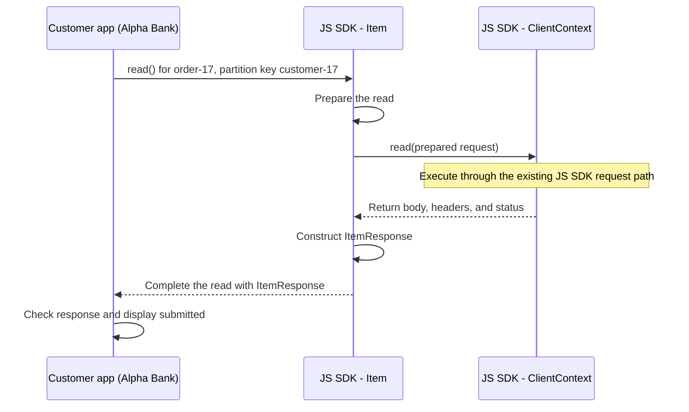

`ClientContext` is the JS SDK's internal request-context class. `Item.read()`
delegates execution to its `read` method after preparing the operation.
We will follow that preparation and delegation in subsequent bites rather
than introduce all the networking and retry machinery now.

The returned **`ItemResponse`** contains the item in `resource` alongside
operation information such as `statusCode`. It is not just the stored order
object. For the example's successful read, `response.resource.status` is
`submitted`.


### What has this bite established?

**Before:** the customer app knows the account, item ID, and partition-key value.
**After a valid read:** it has an `ItemResponse` containing the order and can display
`submitted`; the stored order is unchanged.

**The public call enters `Item.read()`; the JS SDK performs the read and
returns the public response.** This is the boundary we intend to preserve.
No flag or Rust integration has been added, and no workload has run.
The next bite follows how `Item.read()` prepares this supplied-key read
before it calls `ClientContext.read()`.

**References:** [Item.read implementation](../../sdk/cosmosdb/cosmos/src/client/Item/Item.ts),
[ItemResponse](../../sdk/cosmosdb/cosmos/src/client/Item/ItemResponse.ts).

## Bite 2: What happens to the partition key before the read proceeds?

### Alpha Bank's need

Alpha Bank still requests the same order:

```ts
const item = client
  .database("sales")
  .container("orders")
  .item("order-17", "customer-17");

const response = await item.read();
```

The second argument, `"customer-17"`, is the **partition-key value**.
It is not the container's partition-key path, `/customerId`.
The path names the field; the value identifies the order's logical
partition. The JS SDK must preserve that value while preparing the read.

### Follow the interaction

At the start of `Item.read()`, the `Item` class calls
`setPartitionKeyIfUndefined`. Despite its name, this helper also processes
a supplied key. These helpers are standalone exported functions, not class
methods. The diagram therefore names their source modules in the boxes
and puts the function calls on the arrows.

The `Item` constructor already converts the supplied string to
`["customer-17"]`. By the time `read()` calls this helper, the key is
therefore an array; this call preserves that representation.

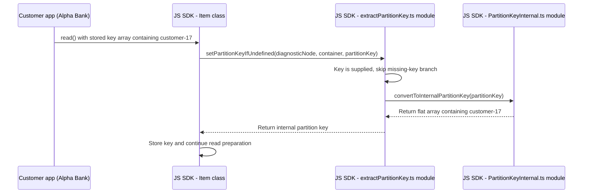

### What does the helper actually change?

The relevant code in `Item.read()` is:

```ts
this.partitionKey = await setPartitionKeyIfUndefined(
  diagnosticNode,
  this.container,
  this.partitionKey,
);
```

`this.partitionKey` is the key stored on this `Item` object.
`diagnosticNode` carries operation diagnostics; it does not supply the
customer's key.

The helper checks whether the key is `undefined`, meaning it was not
supplied. Our key is present, so that branch is skipped. The helper then
calls `convertToInternalPartitionKey`. Distinguish the initial conversion
from the later call during the read:

| Before | Action | After |
|---|---|---|
| `"customer-17"` | Convert the supplied scalar to the internal key representation | `["customer-17"]` |
| `["customer-17"]` stored by the constructor | Normalize again during `read()` | `["customer-17"]`, not `[["customer-17"]]` |

This is **normalization**: changing the representation without changing
which partition the customer requested. If the key is already an array,
the conversion returns an array of its elements rather than nesting it.
This matters when the same `Item` object is read again.

For this supplied string, the helper does not read the container definition
or contact Cosmos. It also does not prove that the order exists or that the
caller supplied the correct key. The actual read establishes the result.

### What if the key were omitted?

Only then does this helper ask for the container's partition-key definition
and construct the SDK's missing-value representation. It does **not**
discover `"customer-17"` by searching for `order-17`.
Our first prototype supplies the key explicitly, so it does not need that
additional behavior.

Later preparation and execution can have their
own requirements.

### What has this bite established?

**Before:** the `Item` object holds the supplied partition-key value.
**After:** it holds that value in the internal array representation, ready
for the remaining read preparation. No order has been returned or changed.

**The existing JS SDK normalizes the supplied key; it does not discover
the order's partition for us.** When designing the NAPI-RS handoff, we must
identify which representation crosses the boundary rather than accidentally
wrapping the key twice.


**References:** [Item.read](../../sdk/cosmosdb/cosmos/src/client/Item/Item.ts),
[setPartitionKeyIfUndefined](../../sdk/cosmosdb/cosmos/src/extractPartitionKey.ts),
[convertToInternalPartitionKey](../../sdk/cosmosdb/cosmos/src/documents/PartitionKeyInternal.ts).

## Bite 3: How does Item identify the read it hands to ClientContext?

### Alpha Bank's need

Alpha Bank still calls:

```ts
const response = await client
  .database("sales")
  .container("orders")
  .item("order-17", "customer-17")
  .read();
```

The JS SDK now has the partition key in its internal representation.
It also needs to tell the next layer **which resource to read**. A key
alone does not identify the database, container, and order.

For this bite, follow the non-encrypted path with partition-level failover
disabled. This is an explicit example condition, not a claim about every
client's configuration.

### First, derive the resource address

`Item.url` is a **getter**: accessing the property runs code that returns
a value. Here it calls the standalone `createDocumentUri` function using
the database, container, and item IDs.

For our example, the resource link is:

```text
dbs/sales/colls/orders/docs/order-17
```

This identifies the item within the account. It is not the account's
network hostname. `colls` and `docs` are the path segments used for
containers and items in this link.

`Item.read()` then calls two standalone functions from `common/helper.ts`:

```ts
const path = getPathFromLink(url);
const id = getIdFromLink(url);
```

| Value | Result for this example |
|---|---|
| `path` | `/dbs/sales/colls/orders/docs/order-17` |
| `id`, passed onward as `resourceId` | `dbs/sales/colls/orders/docs/order-17` |
| `partitionKey` | `["customer-17"]` |

Despite its name, **`getIdFromLink` does not extract only `order-17`**.
It returns the resource link with leading/trailing slashes removed.
The public item's `id` and this internal `resourceId` are different values.

### Follow the interaction

The boxes identify classes or source modules; arrows name the calls.
All participants are inside the existing JS SDK.

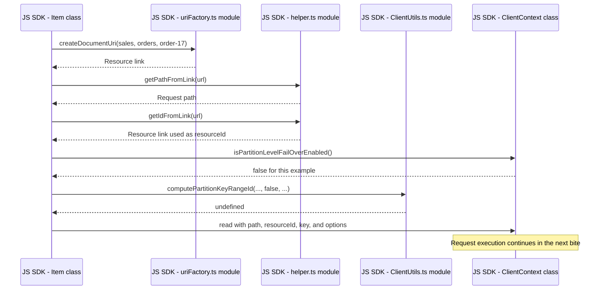

### Why is there a range-ID check?

Before delegating, `Item.read()` asks whether partition-level failover is
enabled. That feature can require a **partition-key range ID**, an
internal routing identifier distinct from the customer's partition key.

In our disabled-feature example, `computePartitionKeyRangeId` returns
`undefined` without requesting the container definition or consulting
the range cache. `Item.read()` still invokes the helper; the helper skips
that work.

If the feature is enabled, the helper obtains the partition-key definition
and, when applicable, asks the range cache to resolve the key's range.
Do not describe that extra lookup as mandatory for every item read.
This distinction does not prove later request execution is metadata-free.

### Then, hand the prepared arguments to ClientContext

`Item` identifies the selected order, but executing the read also needs
the client's settings, authorization headers, session information, and
a destination. **`ClientContext` is an internal JS SDK class that coordinates
these shared facilities.** The customer does not create or call it directly.

For `order-17`, its `read()` method prepares a GET request, builds headers,
applies session information, resolves an endpoint, and delegates execution
through operation plugins to the request handler. It then captures returned
session information. The next bite follows those steps; here we focus on
what `Item` passes into that method.

The current call is:

```ts
response = await this.clientContext.read<T>({
  path,
  resourceType: ResourceType.item,
  resourceId: id,
  options,
  partitionKey: partitionKey,
  diagnosticNode,
  partitionKeyRangeId,
});
```

`resourceType` identifies this as an item operation. `options` carries
the read's operation settings. No order body is supplied: the application
is retrieving the order, not sending a replacement.

### Why pass diagnosticNode with the request?

Suppose the order read is slow or fails. The application needs more than
the order or an error to understand what happened.
**`diagnosticNode` refers to a `DiagnosticNodeInternal` object** that helps
record information as the operation proceeds. This is diagnostic telemetry
collected inside the JS SDK, not another request executor.

For example, `ClientContext.read()` records:

```ts
diagnosticNode.addData({
  operationType: OperationType.Read,
  resourceType,
});
```

Before this call, the node does not have these operation details recorded
by this method. Afterward, it records that the operation is a read of an
item. Adding those details does not send a request or change the order.
Other instrumentation can record network-call durations, statuses, activity
IDs, and request/response sizes.

It is called a **node** because diagnostic steps can form a tree: a step
can contain child steps. Each node also holds a reference to an internal
`CosmosDiagnosticContext`, which accumulates information such as network-call
records. Here, **context** means related information kept together, not a
server or a process.

| Object | Responsibility in this read |
|---|---|
| `Item` | Represents the selected item and exposes `read()` |
| `ClientContext` | Coordinates the client facilities needed to execute the read |
| `diagnosticNode` | Records diagnostic information about the operation or a step within it |

**Collecting diagnostics is different from exporting telemetry.** Passing
this object and recording information in memory does not, by itself, send
that information to an external monitoring system.

For our later VM experiment, the workload's timer measures how long the
public `Item.read()` call takes. Diagnostics help explain that duration
or a failure; their internal timings are not a replacement for the
workload's measurement boundary.

### What has this bite established?

**Before:** `Item` holds the selected resource and key.
**After:** `ClientContext.read()` receives the prepared request arguments.
This handoff has not yet returned `submitted` or changed the stored order.

The next bite follows what `ClientContext.read()` does with these arguments.
No flag, NAPI-RS integration, or performance run is introduced yet.

**References:** [Item.url and Item.read](../../sdk/cosmosdb/cosmos/src/client/Item/Item.ts),
[URI construction](../../sdk/cosmosdb/cosmos/src/common/uriFactory.ts),
[link helpers](../../sdk/cosmosdb/cosmos/src/common/helper.ts),
[computePartitionKeyRangeId](../../sdk/cosmosdb/cosmos/src/client/ClientUtils.ts),
[ClientContext.read](../../sdk/cosmosdb/cosmos/src/ClientContext.ts),
[DiagnosticNodeInternal](../../sdk/cosmosdb/cosmos/src/diagnostics/DiagnosticNodeInternal.ts).

## Bite 4: How does ClientContext turn the read arguments into a request?

### Alpha Bank's need

Alpha Bank still wants `order-17` from `sales/orders`, in partition
`customer-17`. `Item.read()` has passed the identifiers and options to
`ClientContext.read()`. The next step is to combine them with the client
settings needed to execute the operation.

The customer still makes the same call:

```ts
const response = await client
  .database("sales")
  .container("orders")
  .item("order-17", "customer-17")
  .read();
```

The customer does not construct the internal request object.

### First, combine shared settings with this read's inputs

At the beginning of `ClientContext.read()`, the JS SDK creates:

```ts
const request: RequestContext = {
  ...this.getContextDerivedPropsForRequestCreation(),
  method: HTTPMethod.get,
  path,
  operationType: OperationType.Read,
  resourceId,
  options,
  resourceType,
  partitionKey,
};
```

There are two kinds of information here:

| Information | Where it comes from | Example |
|---|---|---|
| Shared client information | The existing `ClientContext` object | Connection settings and the object used to select a service endpoint |
| This operation's inputs | The arguments passed by `Item.read()` | Order resource path and `["customer-17"]` |

`getContextDerivedPropsForRequestCreation()` is a **method on the
`ClientContext` class**. It supplies information already held by the client,
such as connection settings and the object used to select a service
endpoint. `ClientContext.read()` combines that information with the
identifiers and options for this order.

### Follow the interaction

The request is a plain object, not a separate class or service, so it is
shown as work inside `ClientContext`, not as another participant.

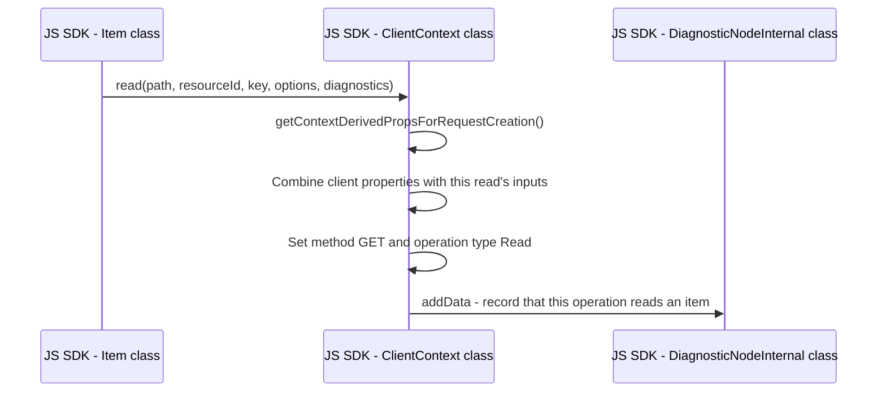

The first arrow summarizes fields of the argument object; the method
receives one object, not separate positional arguments.

### Why call DiagnosticNodeInternal?

The `diagnosticNode` object collects information about this operation.
`ClientContext.read()` calls its `addData` method to label the operation as
**Read** and the resource as **item**. If Alpha Bank investigates a slow or
failed operation, those labels help identify what the recorded diagnostics
describe.

This is the diagnostic telemetry introduced in Bite 3. The call records
information; it does not perform the read or send telemetry to a monitoring
service.

### What does this request contain so far?

For our example:

| Field | Value or meaning |
|---|---|
| `method` | `GET`, the HTTP method used for this read |
| `operationType` | `Read`, the JS SDK's operation classification |
| `resourceType` | `ResourceType.item`, identifying an item operation |
| `path` | `/dbs/sales/colls/orders/docs/order-17` |
| `resourceId` | `dbs/sales/colls/orders/docs/order-17` |
| `partitionKey` | `["customer-17"]` |
| `options` | The operation options passed into the read; an empty object for our call |

`GET` and `Read` describe the same operation at different levels: one is
the HTTP method, the other is the JS SDK's classification.
The request has no order body because we are retrieving an item, not
creating or replacing one.

### Is RequestContext another class like ClientContext?

No. **`ClientContext` is a class with state and methods. `RequestContext`
is a TypeScript interface describing the shape of the request object.**

### What has this bite established?

**Before:** `ClientContext.read()` receives the selected item and operation
options. **After:** a request object combines those inputs with the
shared client information and identifies the operation as a GET/read.
The diagnostic record also identifies this as an item read.

## Bite 5: How does the JS SDK add headers to the order read?

### Alpha Bank's need

Alpha Bank requests `order-17` in partition `customer-17`. The request
object identifies the item, but the service also needs information such
as the partition-key value and authorization for the request.

An **HTTP header** is a named value accompanying a request. It is separate
from the stored order's fields. The JS SDK prepares these values so the
customer does not have to construct them for each read.

For this example, assume the client was configured with an account key,
with no custom headers or extra read options. This is the credential path
we follow here, not a requirement that every application use an account key.
The public call remains:

```ts
const response = await client
  .database("sales")
  .container("orders")
  .item("order-17", "customer-17")
  .read();
```

### Follow the interaction

`ClientContext.read()` calls its own `buildHeaders` method:

```ts
request.headers = await this.buildHeaders(request);
```

`buildHeaders` passes the client settings and this read's details to
`getHeaders`, a standalone function in `request/request.ts`.
That function assembles the headers and calls the authorization helper
for our account-key example.

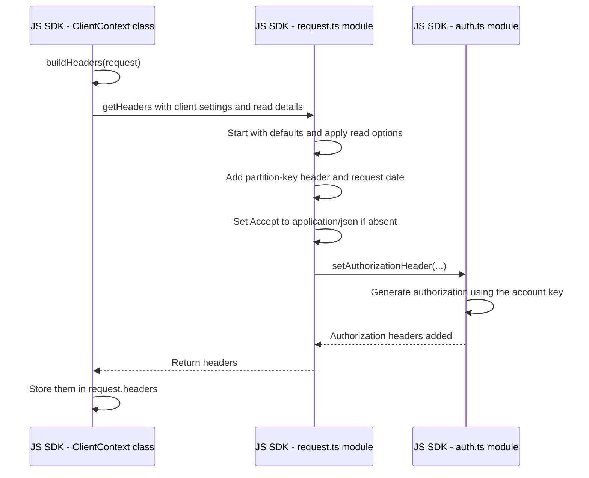

`request.ts` and `auth.ts` contain the standalone functions shown on the
arrows; they are not additional classes.

### How does the partition key become a header?

The request holds the internal array `["customer-17"]`. With no
partition-key header already supplied, `getHeaders` converts that array
to JSON text and assigns it to the partition-key header:

```text
x-ms-documentdb-partitionkey: ["customer-17"]
```

The value on the wire is text representing the array. It is not an order
body and does not change the stored `customerId`.

Here are selected headers relevant to our example, not the complete set:

| Header | What the JS SDK supplies | Why it is present |
|---|---|---|
| `x-ms-documentdb-partitionkey` | JSON text `["customer-17"]` | Identifies the requested logical partition |
| `Accept` | `application/json` if not already supplied | Indicates the expected response format |
| `x-ms-date` | Request date for this account-key path | Participates in request authorization |
| `authorization` | Generated authorization value | Lets the service check authorization for the request |

The account key is used to generate authorization; the JS SDK does not
put the raw account key into that header. Generating the header is not
proof that the service will accept it. An invalid key can still produce
an authorization failure when the request executes.

### Where do defaults and read options fit?

`buildHeaders` starts with the client's default headers and any
`options.initialHeaders` supplied for the operation. For the same header
name, the operation's initial value takes precedence in that initial
combination. `getHeaders` then applies its own header-building rules.

Our call supplies no extra options, so there is no operation-specific
override to follow. The customer continues to supply the item ID and
partition-key value through the public API rather than constructing a
header collection.

### What has this bite established?

**Before:** the request object identifies the order and carries the read
options. **After:** `request.headers` contains the headers assembled for
that read, including its partition key and account-key authorization.

**`ClientContext` coordinates header preparation; the functions in
`request.ts` and `auth.ts` build the values.** The order's fields remain
unchanged.

After header preparation, the existing read calls `applySessionToken`
to apply saved session information when applicable. Its internal mechanism
is outside this proof-of-concept walkthrough; we are not removing that
behavior from the SDK.

## Bite 6: How does the read choose the service address?

**Bite 6 of approximately 24.**

### Alpha Bank's need

The request identifies `/dbs/sales/colls/orders/docs/order-17`, but that
path does not say which service address to contact.

An **endpoint** is the service's base address, separate from the path
identifying the order. For example:

```text
Endpoint: https://alpha-bank.documents.azure.com/
Path:     /dbs/sales/colls/orders/docs/order-17
```

The endpoint above is illustrative. The SDK must select the address
appropriate for this client's read.

### Who chooses it?

`ClientContext` asks **`GlobalEndpointManager`**, the internal class
responsible for selecting service endpoints. This keeps the address
selection out of `Item.read()`: `Item` identifies the order, while
`GlobalEndpointManager` knows the client's available service locations.

The relevant call inside `ClientContext.read()` is:

```ts
request.endpoint = await this.globalEndpointManager.resolveServiceEndpointInternal({
  diagnosticNode: diagnosticNode,
  resourceType: request.resourceType,
  operationType: request.operationType,
  startServiceEndpointIndex: 0,
  excludedLocations: options?.excludedLocations,
});
```

For our request, the resource type is item and the operation is Read.
The manager uses the read operation to select from readable locations.

### Follow the interaction

For this diagram, suppose the manager already has the account's location
information:

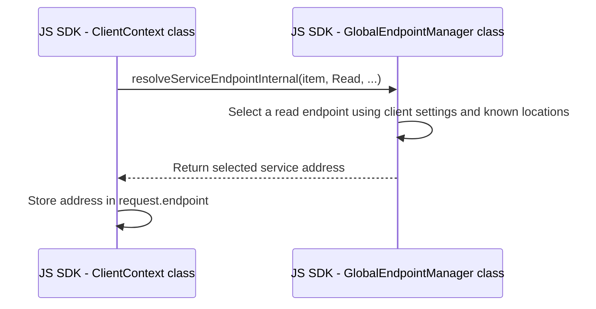

The manager considers configured preferred locations, exclusions, and
locations marked unavailable. We do not need the regional-selection
algorithm for this proof of concept.

Two details matter for understanding the existing flow:

- If endpoint discovery is disabled, the manager returns the endpoint
  supplied by the customer app.
- If discovery is enabled and the account's location lists are missing,
  the manager first requests account information from the service backend.
  That is a separate request for account information, not the order read.

### What has this bite established?

**Before:** the request identifies the order and has its prepared headers.
**After:** `request.endpoint` also holds the selected service address.

The responsibility is now clear: **`Item` identifies what to read;
`GlobalEndpointManager` selects where to send the request;
`ClientContext` keeps those details together.**

## Bite 7: How does the prepared read enter request execution?

**Bite 7 of approximately 24.**

### Alpha Bank's need

The request now identifies `order-17` and carries headers and a service
address. `ClientContext` must hand it to the code that executes the read.

The relevant call is:

```ts
const response = await executePlugins(
  diagnosticNode,
  request,
  RequestHandler.request,
  PluginOn.operation,
);
```

`RequestHandler.request` is the function to continue with. It is passed
to `executePlugins`, rather than called directly on this line.

### Why is executePlugins in the middle?

A **plugin** is an optional function that can customize SDK behavior
around an operation, such as adding logging. `PluginOn.operation`
identifies the hook around the overall API operation.

For our example, no plugins are configured. `executePlugins` immediately
calls `RequestHandler.request` with the prepared request and diagnostic
node. We do not need plugin internals for this proof of concept.

### Who manages an attempt?

An **attempt** is one try at executing the request. A **retry** is another
attempt after a failure that the SDK's retry rules allow it to handle.

`RequestHandler.request` hands control to `execute` in `retryUtility.ts`,
passing `executeRequest` as the function to run for an attempt:

```ts
return RetryUtility.execute({
  diagnosticNode: childNode,
  requestContext,
  executeRequest,
});
```

This separates two responsibilities: the retry utility manages attempts;
`executeRequest` carries out an attempt. The surrounding diagnostic code
groups the records for those attempts under this request.

### Follow the interaction

Follow the first attempt, with no plugins configured:

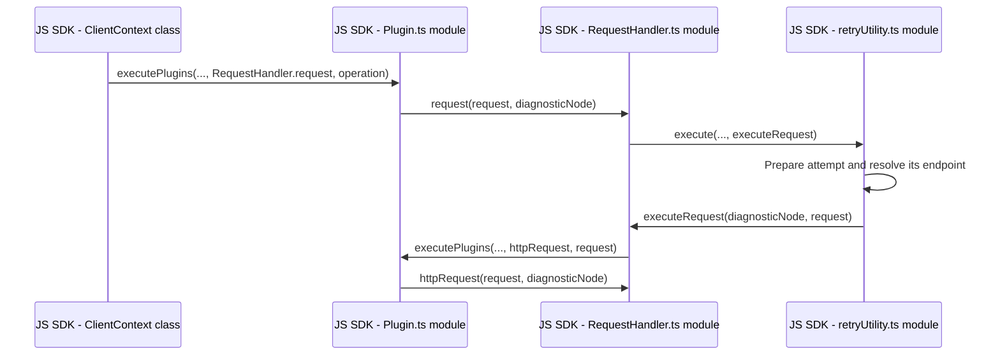

The second plugin call is around an individual request attempt, rather
than the overall operation. With no plugins configured, it immediately
continues to `httpRequest`.

`RequestHandler.ts` is a module, not a class. Its exported
`RequestHandler` object exposes the `request` function.

### What has this bite established?

**Before:** `ClientContext` holds the prepared read.
**After:** execution has reached `httpRequest` through the attempt-management
code.

One detail connects this to Bite 6: the retry utility resolves the endpoint
again for the attempt. The earlier `request.endpoint` assignment is not
the only place the existing read selects a service address.

## Bite 8: Where does the order read get sent?

**Bite 8 of approximately 24.**

### Alpha Bank's need

Preparing the read is not enough to retrieve `order-17`. The SDK needs
to send it to the service backend and receive a response.

We continue with the account-key example.

### Why does the Cosmos JS SDK use a shared Azure HTTP library?

The Cosmos JS SDK knows how to describe Alpha Bank's order read: the
item path, partition key, and Cosmos headers. Sending an HTTP request
and receiving its response is work other Azure SDKs need too.

Rather than implementing all that communication itself, the Cosmos JS SDK
uses **`@azure/core-rest-pipeline`**, a JavaScript package providing shared
HTTP functionality. This is the same general separation as the legacy
Python SDK using `azure-core`: Cosmos-specific code prepares the operation,
and shared Azure code provides HTTP communication.

An **HTTP client** is the code responsible for sending HTTP requests
and receiving their responses. In the path we are following, the Cosmos
JS SDK obtains this client from `@azure/core-rest-pipeline`.
The same package also provides helpers to prepare the request.

These are libraries running inside Alpha Bank's Node.js process, not
another Azure service the request visits. The remote destination is the
**gateway**, the front end of the Cosmos service backend.

### Turn the prepared details into an HTTP request

`httpRequest` combines the selected endpoint and item path into a complete
address and prepares the request for the SDK's HTTP client.

The package's `createHttpHeaders` and `createPipelineRequest` helpers
put the read's details into the form the HTTP client accepts.

For our example, the request contains:

| Detail | Value |
|---|---|
| Complete address | Selected endpoint followed by `/dbs/sales/colls/orders/docs/order-17` |
| Method | `GET` |
| Headers | The headers prepared for this read |
| Body | None; the customer app is retrieving the order |

Preparing this request object does not send it.

### Hand the request to the HTTP client

For our account-key path, `httpRequest` calls the HTTP client's
`sendRequest` method with the prepared request and waits for its response.

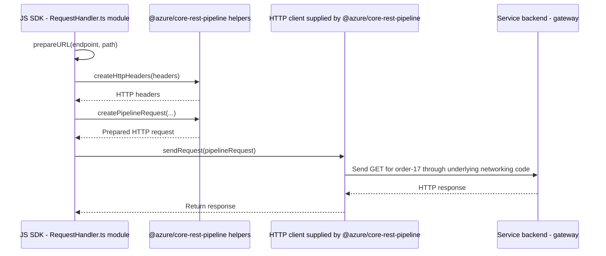

The helper and HTTP-client boxes show two responsibilities supplied by
the same package, not two separate services.

The backend exchange in the diagram represents the successful attempt.
Sending can also fail; a call to `sendRequest` is not itself proof that
the order was retrieved.

### What has this bite established?

**Before:** the SDK has selected the destination and prepared the read's
details. **After a successful exchange:** `httpRequest` has an HTTP
response containing a status, headers, and body text.

**The Cosmos JS SDK prepares the order read; the HTTP client supplied by
the shared Azure package handles sending and receiving.**
This response is still internal to the SDK, not yet
the public `ItemResponse` returned to the customer app.

## Bite 9: How does the response become the order the customer app reads?

**Bite 9 of approximately 24.**

### Alpha Bank's need

The HTTP client has received a response from the service backend.
Alpha Bank needs the order's fields, such as `status: "submitted"`,
not just the text received over HTTP.

We follow a successful read of `order-17`, with HTTP status `200`,
meaning the request succeeded. The item remains non-encrypted in this
example.

### Turn response text into an order object

Inside `httpRequest`, the SDK converts the response's JSON text into a
JavaScript object. **JSON** is the text format used to represent the
order's fields; converting it makes those fields accessible to the
customer app as object properties.

`httpRequest` packages that object with the response headers and status
in an internal response. At this stage, the order object is stored in
the internal field named `result`.

That response travels back through the execution path to
`ClientContext.read()`, which returns it to `Item.read()`.

### Why does Item.read create an ItemResponse?

The internal response is the SDK's working format.
**`ItemResponse` is the public response object returned by `Item.read()`.**
It gives the customer app a consistent place to find both the order and
information about the operation.

`Item.read()` creates this object using the internal response's order,
headers, and status. The order stored internally as `result` becomes
the public `resource` property.

### Follow the return path

The diagram condenses the plugin and attempt-management steps already
covered in Bite 7:

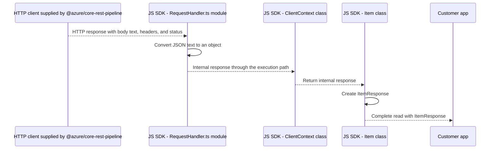

### What does Alpha Bank receive?

For our successful example:

| Public response property | What the customer app receives |
|---|---|
| `resource.id` | `"order-17"` |
| `resource.customerId` | `"customer-17"` |
| `resource.status` | `"submitted"` |
| `statusCode` | `200` |
| `headers` | Response headers from the operation |
| `item` | The SDK `Item` object representing the requested order, not the order's stored fields |

These are illustrative values for the same order, not results from a
prototype run.

One distinction matters for the proof of concept: `Item.read()` also
returns an `ItemResponse` for a not-found (`404`) result. Finishing the
call without an exception is therefore not enough to establish a
successful read; we must check the status and expected order fields.

### What has this bite established?

**Before:** `httpRequest` has an HTTP response containing body text.
**After:** the customer app receives an `ItemResponse`, with the order
object in `resource` and the operation's status in `statusCode`.

This completes the existing read's round trip from the public call to
the service backend and back to the customer app.

## Bite 10: Where should the read hand responsibility to Rust?

**Bite 10 of approximately 24.**

### Alpha Bank's need

Alpha Bank still wants `order-17` through the same public `Item.read()`
call, with the order returned in `ItemResponse.resource`.
For the experiment, we want the Rust driver to perform that read instead
of the existing JavaScript execution path.

**This bite describes the proposed integration, not code already added.**

### Why not replace only the HTTP client?

The HTTP client sends a request that the JS SDK has already prepared.
By that point, the JS SDK has built headers, selected an endpoint, and
entered its retry handling.

Our goal is to hand the Rust driver the **item operation**, not an HTTP
request already managed by JavaScript. Otherwise, the existing JavaScript
execution machinery would remain around the driver rather than being
replaced for this read.

### What happens to the shared Azure HTTP library from Bite 8?

**The proposed Rust read no longer uses JavaScript's
`@azure/core-rest-pipeline` to prepare or send its service requests.**
The Rust driver takes responsibility for that communication instead.
The NAPI-RS binding connects JavaScript to the driver; it does not send
the driver's requests through the JavaScript HTTP client.

This removes the shared JavaScript HTTP library from the selected Rust
read's execution path, not from the entire SDK package. The existing
JavaScript path and operations not migrated to Rust can still use it.
It also does not imply that the Rust driver has no shared HTTP libraries
of its own.

### Keep the public entry, change who executes the read

The proposed branch belongs inside `Item.read()`, before entering the
existing read-preparation and `ClientContext.read()` execution path.

For the selected Rust path, the SDK passes the operation's inputs:
database `sales`, container `orders`, item `order-17`, and partition-key
value `customer-17`. Account configuration belongs to the client's setup;
the customer app does not supply it again on each read.

A **binding** is the code that lets JavaScript call Rust functions.
We write that binding in Rust using **NAPI-RS**. Its job is to transfer
the read inputs to the Rust driver and bring the result back to JavaScript,
not to implement another set of Cosmos routing and retry rules.

The binding and driver run inside the customer's Node.js process.
There is no new intermediary service in this experiment.

### Follow the proposed Rust path

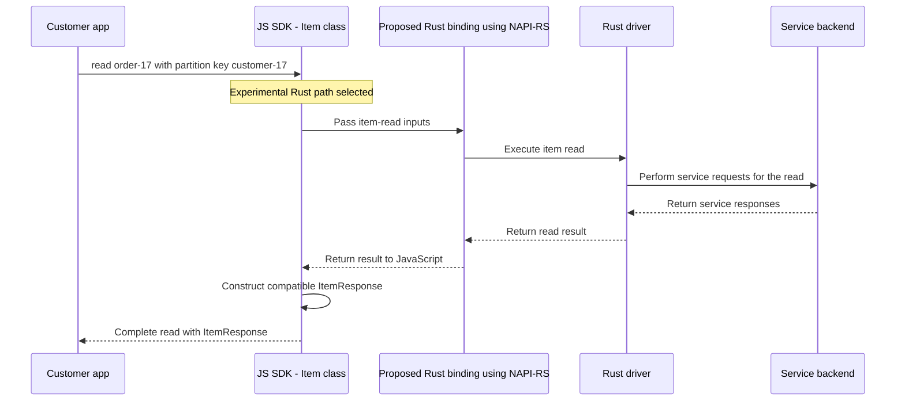

This diagram shows responsibilities, not new function or class names
that have already been implemented.

### What stays in JavaScript, and what moves?

| Responsibility | Proposed owner |
|---|---|
| Public `Item.read()` call and supported-input checks | JS SDK |
| Transfer inputs and results between JavaScript and Rust | NAPI-RS binding |
| Service information lookups, endpoint selection, session handling, retries, and HTTP communication for the Rust read | Rust driver |
| Present the result as the existing public `ItemResponse`, with compatible error behavior | JS SDK |

The existing JavaScript path remains the default. Selecting Rust must
not silently fall back to JavaScript if the Rust read fails; otherwise
we could mistake a JavaScript read for a working Rust integration.

### What has this bite established?

**The proposed handoff is at the item-operation level, not at the HTTP
send call.** The customer app keeps its public API, while the selected
Rust path bypasses the legacy JavaScript execution machinery for that read.

## Bite 11: How do we choose JavaScript or Rust for the experiment?

**Bite 11 of approximately 24.**

### Alpha Bank's need

We need to run the same `order-17` read using each implementation so
we can compare the results and latency. Changing the customer app's
read call between runs would make that comparison harder to control.

An **experimental switch** is a setting that selects which implementation
executes the read. The public call remains `Item.read()` in both cases.

**This describes the intended selection flow. Bite 12 implements the
switch; the Rust binding and successful Rust read are still pending.**

### Select the implementation when the client is created

For this local experiment, the switch is an **environment variable**:
a named setting supplied to the Node.js process before the workload starts.
Its name is `AZURE_COSMOS_EXPERIMENTAL_READ_IMPLEMENTATION`, with values
`javascript` or `rust`.

`CosmosClient` would read that setting during construction and retain the
choice for that client's lifetime. `Item.read()` would use the retained
choice rather than check the environment on every call.

That gives each client a stable execution path. Changing the setting
would not switch an already-created client from JavaScript to Rust.

### Follow the proposed selection

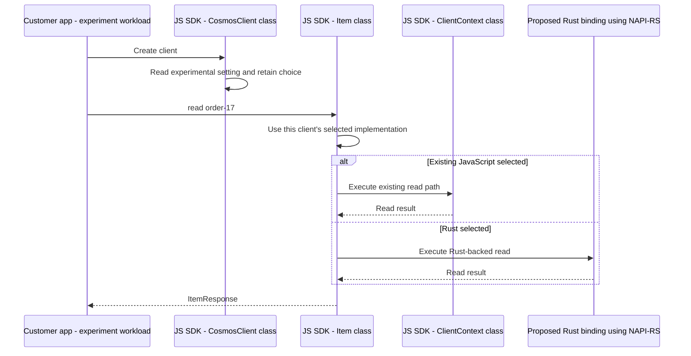

The diagram follows successful reads. Both choices preserve the public
response shape described in Bite 9.

### What should the switch do?

| Setting or condition | Proposed behavior |
|---|---|
| Setting absent | Keep the existing JavaScript path |
| Existing JavaScript explicitly selected | Use the existing JavaScript path |
| Rust explicitly selected | Use the Rust path for the supported item read |
| Unrecognized setting value | Reject it with a clear error |
| Rust cannot load or execute | Report the failure; do not substitute a JavaScript read |

The switch selects this prototype's item-read path. It does not claim
that other public APIs have been migrated to Rust.

### How does this support the comparison?

Run the workload once in a Node.js process configured for JavaScript,
then in a separate process configured for Rust. Both runs read the same
prepared order with the same public call and equivalent workload settings.
Each run records which implementation was selected.

The setting records our intent, not proof that Rust actually executed.
The experiment must also verify the selected path before treating a run
as a Rust result.

### What has this bite established?

**Choose once at client creation, keep the public read unchanged, and
make selection errors visible.** This lets us compare two implementations
without silently mixing them within a run.

## Bite 12: How does the implemented switch select the read path?

**Bite 12 of approximately 24.**

### Alpha Bank's need

Alpha Bank needs to select the read implementation without changing its
`Item.read()` call. This bite follows the switch now implemented in the
SDK, rather than another proposed design.

The changes are on the local `rust-prototype` branch. This step implements
selection only, not a working Rust read.

### What did we implement?

When the customer app constructs `CosmosClient`, the SDK reads
`AZURE_COSMOS_EXPERIMENTAL_READ_IMPLEMENTATION`. It validates the value
before initializing the client and stores the selection in the client's
internal `ClientContext`.

The work is split between three components:

| Component | What the implemented code does |
|---|---|
| `getExperimentalReadImplementation` in the `envUtils.ts` module | Reads the environment setting, supplies the JavaScript default, and rejects invalid values |
| `CosmosClient` | Calls that helper once during construction and passes the choice into `ClientContext` |
| `Item.read()` | Checks `ClientContext.experimentalReadImplementation` before starting read preparation |

| Environment setting | Current behavior |
|---|---|
| Not set | Use the existing JavaScript read |
| `javascript` | Use the existing JavaScript read |
| `rust` | Create the client, but reject item reads as not implemented |
| Any other value, including an empty string | Reject client construction with a clear error |

The choice stays fixed for that client. For example, create client A
with the setting absent, then change the setting to `rust` and create
client B. Client A still performs JavaScript reads; client B rejects item
reads as not implemented. Changing the setting again does not change
either existing client's choice.

### Where does Item.read check the choice?

`Item.read()` checks the stored selection before partition-key preparation
or calling the legacy read path. With `rust` selected, it reports:

> Experimental Rust item reads are not implemented yet.

That failure uses the existing diagnostic error handling. It does not
perform the item read, fetch missing partition-key information, or fall
back to JavaScript.

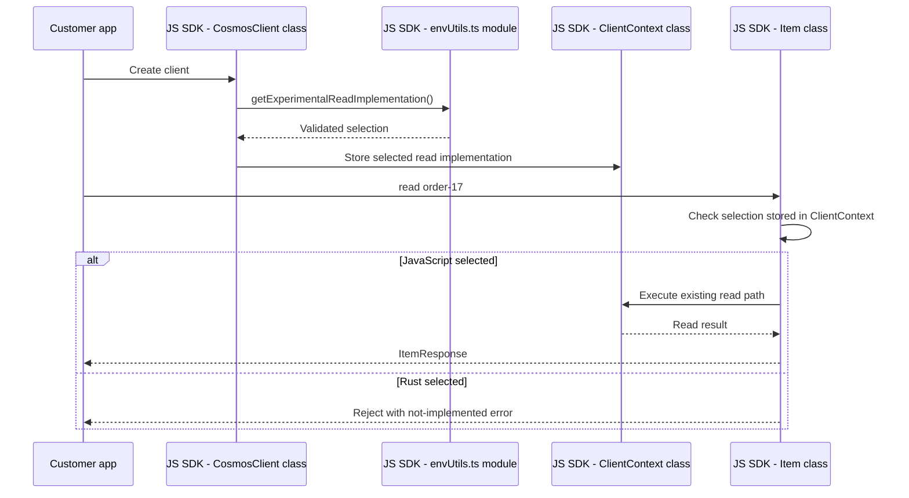

Only item reads are gated. Other operations retain their existing behavior.
The switch also does not disable the client's existing background work.

### Why does Rust selection fail at this stage?

The switch is ready, but the NAPI-RS binding is not connected yet.
Returning a JavaScript result in the Rust branch would hide that missing
implementation. The explicit failure proves we did not silently take the
JavaScript path; it does not prove that any Rust code ran.

### What do the focused checks cover?

The added tests exercise the public client and item-read call with a
controlled HTTP response. They cover the default and explicit JavaScript
paths, invalid values, fixed per-client selection, the existing not-found
response, and rejection before item or missing-key requests on the Rust
path. They also check that a database read is not redirected.

These are local behavior checks, not a comparison against the Rust driver
or a live service performance result.

The package build, 11 focused tests, package lint, formatting check, and
focused source/test type-check passed. Built CommonJS behavior and the
browser's JavaScript-only selection were also checked. The full test
type-check remains blocked by errors in unchanged test files.

### What has this bite established?

**The switch is implemented, and the JavaScript read remains available.
Rust selection fails explicitly until the binding is connected.**
No NAPI-RS binding, successful Rust read, or benchmark is claimed by this step.

## Bite 13: Can Node.js call our compiled Rust binding?

**Bite 13 of approximately 24.**

### Alpha Bank's need

The switch can select Rust, but selection alone does not make Rust code
callable. Before connecting the separately owned driver, we need to prove
that Node.js can load our binding, send it a value, and receive its result.

This bite implements that boundary on `rust-prototype`. It uses a **probe**:
a small function that exercises the connection without pretending to read
an item. Sending `order-17` returns `rust-probe:order-17`, not the stored
order or its `submitted` status.

### Why do we need a separate build?

The existing SDK build prepares JavaScript. Our Rust source must instead
be compiled into machine code before Node.js can execute it.
A **native addon** is a compiled library that Node.js loads into its own
process. Its filename ends in `.node`.

**Cargo**, Rust's build tool, compiles our binding and its NAPI-RS
dependencies. NAPI-RS supplies the code that makes the Rust function
callable through Node.js's native interface, **Node-API**.
We are not building the Rust driver yet.

The local build has two steps:

```text
Cargo compiles the Rust binding and its dependencies
    -> the build helper copies Cargo's library to a .node file
    -> Node.js can load that file
```

The helper uses the library path reported by Cargo rather than guessing
where the compiler put it. If compilation fails, the helper fails too;
it removes the previous addon before building so that an old binary cannot
masquerade as the new result.

The crate's `Cargo.lock` records the resolved Rust dependencies. The build
uses `--locked`, which rejects a dependency change that would require
updating that file.

### What happens when JavaScript calls the probe?

The local test loads the addon and calls its `probeAsync` function.
This is a direct binding check, not a call through `Item.read()`.

The call returns a **Promise**, JavaScript's representation of an operation
whose result or failure becomes available asynchronously. This matters
because the eventual read will need to wait for the service backend rather
than return an item immediately.

To run the Rust asynchronous function, NAPI-RS provides a **Tokio runtime**:
the machinery that schedules asynchronous Rust work. Our probe briefly
yields to that runtime, then creates the result string. NAPI-RS converts
the result back into a JavaScript string and completes the Promise.
There is no separately running Rust service.

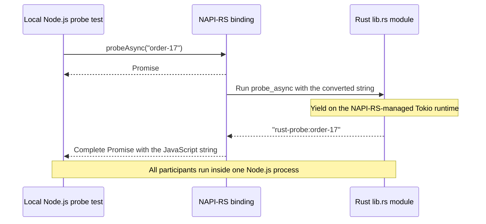

Failures must cross the same boundary visibly. For this probe only, an
empty string makes Rust return an error. NAPI-RS turns it into a rejected
Promise with the message:

> The native probe requires a non-empty value.

This is a probe rule, not a new Cosmos item-ID validation rule.

### How do we build and run this locally?

With Node.js, Cargo, and the platform's native linker available, run these
commands from `sdk\cosmosdb\cosmos`:

```powershell
npm run build:rust-prototype
npm run test:rust-prototype
```

These are explicit prototype commands. They do not replace the normal SDK
build, add an installation hook, or require a separate npm build dependency.
The tests use Node.js's built-in test runner to load the actual addon,
without a mock binding.

The Rust source, lockfile, build helper, and tests live in the package's
`rust-prototype` directory. Compiler output and the `.node` file are ignored
by Git. This directory is not added to the SDK's published package files,
and normal SDK imports do not load the addon.

### What has this bite established?

The native build and four probe tests passed locally on Windows x64 with
Node.js 22.23.3 and Rust 1.92.0. The checks cover Promise completion, string
conversion including Unicode and embedded null characters, Rust error
rejection followed by a successful call, and 32 overlapping calls retaining
their own inputs.

**Node.js can now execute our compiled asynchronous Rust binding.
It still cannot perform a Rust-backed item read.** No Rust driver,
credentials, gateway request, or `ItemResponse` is involved in this probe.
`Item.read()` deliberately keeps its previous Rust not-implemented error.
This local build is not a cross-platform packaging result, and the small
overlap check is not a threading, scalability, or performance qualification.

## Bite 14: How do we create and keep a real Rust driver?

**Bite 14 of approximately 24.**

### Alpha Bank's need

The probe can pass `order-17` into Rust, but it has no account connection
or Cosmos behavior. To read the order, the binding needs a real driver
configured for Alpha Bank's account.

That driver should remain available for later calls. Recreating it for
every read would repeat initialization and discard the state intended
to serve subsequent operations.

This bite adds `NativeReadClient`, an internal class exposed by the
compiled binding. It creates and holds the real Rust driver. It is not
a replacement public `CosmosClient`, and the SDK's `Item.read()` is not
connected to it yet.

### Why does the binding create two Rust components?

The driver separates shared resources from account-specific state:

| Component | Responsibility in this step |
|---|---|
| `CosmosDriverRuntime` | Holds transport configuration and shared resources such as metadata caches |
| `CosmosDriver` | Holds the selected account and its initialized routing and transport state |
| `NativeReadClient` | Keeps a reference to that driver so later binding calls can use it |

`CosmosDriverRuntime` is different from the **Tokio runtime** introduced
in Bite 13. Tokio schedules asynchronous Rust work. `CosmosDriverRuntime`
holds Cosmos-specific resources used by the driver. Both are needed here;
they are not two names for the same component.

The binding creates a new `CosmosDriverRuntime` for each native client in
this step. It does not introduce a process-wide cache that silently shares
account clients. The created driver itself keeps the runtime alive.

### Why is creating the native client asynchronous?

JavaScript calls `NativeReadClient.create(endpoint, accountKey)`. This is a
**factory method**: a method that creates and returns an instance.
Unlike a normal JavaScript constructor, this factory can return a Promise
and finish creating the instance after asynchronous work completes.

The endpoint identifies the account gateway. The account key supplies
credentials for the driver to authorize its requests. The binding first
rejects malformed endpoints, non-HTTPS endpoints, endpoints containing
embedded credentials or resource paths, and empty keys.

It then builds `CosmosDriverRuntime` and calls its `create_driver` method.
The important discovery from the driver code is that **`create_driver`
immediately initializes the account**. It fetches account metadata from
the gateway and establishes the appropriate transport; it does not merely
store the endpoint and key for later.

The factory therefore completes only after that initialization succeeds.
If runtime creation or account initialization fails, its Promise rejects.
There is no JavaScript read fallback.

Runtime creation also initializes the driver's system-monitoring resources.
Those can perform a machine-metadata lookup independently of the Cosmos
account request. Creating this native client is not a network-free setup step.

### Follow initialization

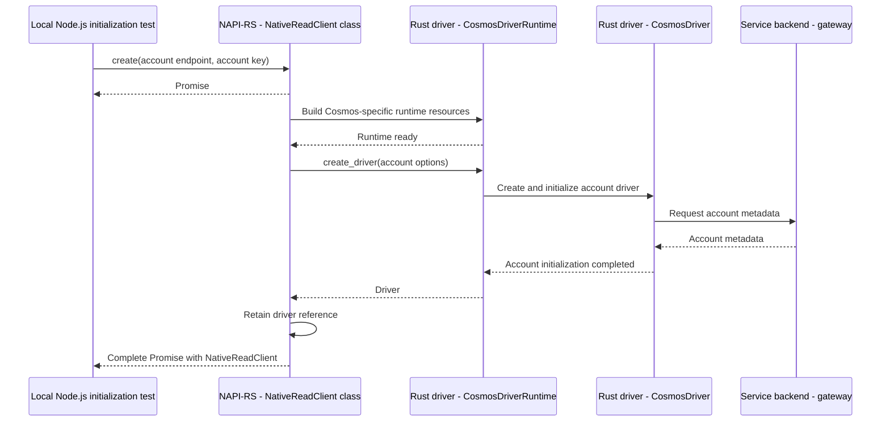

The test calls the binding directly so that we can establish this behavior
before changing the public read path. It does not request `order-17`.

### What stays alive, and how do we release it?

After creation, `NativeReadClient` holds the driver rather than constructing
another one on each access. Its `accountEndpoint` property reads the endpoint
from that retained driver.

The binding provides `close()` to release its driver reference explicitly.
Calling `close()` twice is harmless; accessing `accountEndpoint` afterward
throws a closed-client error. A short internal lock protects access to the
stored reference, and the binding releases the driver outside that lock.

This release does not mean that every process-wide resource has stopped.
The NAPI-RS Tokio runtime and driver system-monitoring resources have their
own lifetimes. Nor does this step establish cancellation of in-flight reads:
there is no native read method yet.

### How do we run this step?

The binding now depends directly on `azure_data_cosmos_driver`, pinned to
revision `84e2bb66c9911fa730dc9756c8fc3f9612456344`. This matches the Python
binding's inspected dependency revision. Cargo builds that pinned source;
it does not require editing or building the neighboring Rust checkout.
The binding's lockfile records the resolved dependency graph.

From `sdk\cosmosdb\cosmos`, build the addon and run the local checks:

```powershell
npm run build:rust-prototype
npm run test:rust-prototype
```

For the separate live initialization check, make `ACCOUNT_HOST` and
`ACCOUNT_KEY` available in the process environment, then run:

```powershell
npm run test:rust-prototype:live
```

The live check fails if either variable is missing; it does not silently
skip or use another account. It creates the native client, checks the retained
endpoint without printing it, closes the client, and checks the closed state.
It does not create resources, modify items, or perform an item read.

### What has this bite established?

The binding built with the pinned driver. All seven local probe and input
checks passed. The separate live check also passed against the configured
test account: JavaScript received an initialized native client and could
release its reference.

**The binding can now create and retain a real, account-initialized Rust
driver.** The next operation can use that driver rather than starting from
the string probe.

`Item.read()` still rejects Rust selection. No public JS-to-Rust read,
`ItemResponse` conversion, Gateway V2 data request, or performance result
is claimed. Successful account initialization alone does not establish
which gateway path a later item read will use.

## Bite 15: How does the native client read an item?

**Bite 15 of approximately 24.**

### Alpha Bank's need

Account initialization gives the binding a usable driver, but it does not
return `order-17`. The next step is to give that driver the database,
container, item ID, and partition-key value, then bring the result back to
JavaScript.

This bite adds the internal binding method:

```js
nativeClient.readItem("sales", "orders", "order-17", "customer-17");
```

Here, `nativeClient` is an already initialized `NativeReadClient` from
Bite 14. This call returns a Promise. It is not a new public SDK method:
the customer-facing `container.item(id, partitionKey).read()` is still
unconnected to the binding.

The implementation accepts one **string partition-key value**, such as
`customer-17`. It does not infer the value from the item or implement
numeric, null, or hierarchical partition keys. Empty resource names reject;
an empty string partition-key value is not treated as missing.

### Why does the driver need container metadata before reading the order?

The four inputs identify what Alpha Bank wants, but a container name alone
does not describe how its data is partitioned. The driver needs the
container's service identity and partition-key definition to prepare the
operation.

The binding therefore calls `CosmosDriver.resolve_container` first.
The driver uses its cached metadata when available and fetches container
metadata on a cache miss. Its current default behavior can also prepare
partition-topology information. The binding does not duplicate this work
with the legacy JavaScript routing code.

Once the container is resolved, the binding creates an `ItemReference`:
the driver's description of an item in that container, with the supplied
ID and partition-key value. It passes that reference to
`CosmosOperation::read_item`, then asks the retained driver to execute it.

The driver owns routing, authorization, transport, and retries. This is
why responsibility moves into the driver before those activities, rather
than returning to the JavaScript request pipeline.

### What happens if JavaScript closes the client while the read is waiting?

The binding must not allow `close()` to remove the only driver reference
needed by a read that has already started.

At entry to `readItem`, on the JavaScript thread, it takes its short lock
and clones the driver's `Arc`. This creates another reference to the
**same driver**, not another driver or connection pool. It releases the
lock before scheduling the asynchronous operation.

For this method, the binding uses NAPI-RS's `AsyncBlockBuilder` to schedule
the future and return a Promise after that ownership step. Merely placing
the reference acquisition inside an `async fn` would not establish that
it happened before JavaScript's next `close()` call.

The resulting contract is:

- A call that acquired its driver reference can finish after `close()`.
- A later call observes the closed state and its Promise rejects.
- `close()` remains synchronous and idempotent. It does not wait for,
  cancel, or report the result of an accepted read.

No lock is held while container metadata or the item response is awaited.
The operation's reference keeps its driver alive for that work.

### What crosses back into JavaScript?

The driver can receive Cosmos binary-encoded item data. JavaScript's
`JSON.parse` expects JSON text, not those protocol bytes, so the binding
must establish the body format before returning it.

The read explicitly requests **text response conversion** from the driver.
Binary encoding remains enabled for the service exchange; when necessary,
the driver converts the successful body to JSON text before handing it back.
This is not a claim that the network response itself was text.

The binding copies those bytes into an owned Node.js `Buffer`. The copy
separates the JavaScript result's lifetime from the driver's response.
This is deliberately not a zero-copy or performance claim. Converting
binary JSON to text also need not preserve the original textual ordering
or number formatting.

The native result contains:

| Field | What JavaScript receives |
|---|---|
| `statusCode`, `subStatusCode` | The operation status and any more-specific Cosmos status |
| `body` | A Buffer containing the successful item's UTF-8 JSON text |
| `requestCharge` | The reported request charge, when present |
| `activityId` | The service request identifier, when present |
| `etag` | The item's version marker, when present |
| `sessionToken` | The returned consistency token, when present; this bite does not add a public token option |
| `retryAfterMs` | Any retry delay, preserved as a decimal string rather than narrowing its integer range |
| `diagnostics` | Total and retained attempt counts, plus each retained attempt's pipeline, transport, and status |

These are selected driver fields, **not the complete original HTTP headers
or a public `ItemResponse`**. Diagnostics omit account endpoints and item
contents. A retained attempt is one kept in the driver's bounded diagnostic
record; the total count can exceed the retained count.

JavaScript can decode the Buffer and parse its JSON. The Rust binding does
not introduce an `Order` structure that would discard fields it did not know
about. A missing operation response, empty successful body, or feed-shaped
body rejects explicitly instead of becoming a successful empty item.

### How do failures return?

A driver failure rejects the native Promise. The JavaScript `Error` carries
`stage`, `statusCode`, `subStatusCode`, `fromWire`, and any response and
diagnostics the driver retained.

`stage` distinguishes container resolution from the item operation.
`fromWire` distinguishes a finalized service response from a driver-generated
failure. An attached error response preserves its body bytes and selected
metadata; unlike a successful item body, those error bytes are not promised
to have undergone the successful-response text conversion.

The asynchronous work returns Rust values first. NAPI-RS then runs the
completion callback on the JavaScript thread, where the binding constructs
the JavaScript result or the enriched `Error`. It does not manipulate
JavaScript objects from the Tokio task.

This is intentionally a lower-level contract than public `Item.read()`.
The executed missing-item comparison demonstrated an important difference:
the legacy public call fulfills with status 404 and no `resource`, while
the native call rejects with status 404. Preserving the public behavior is
work for the wrapper integration, not a reason to hide the native error.

### Follow the successful native operation

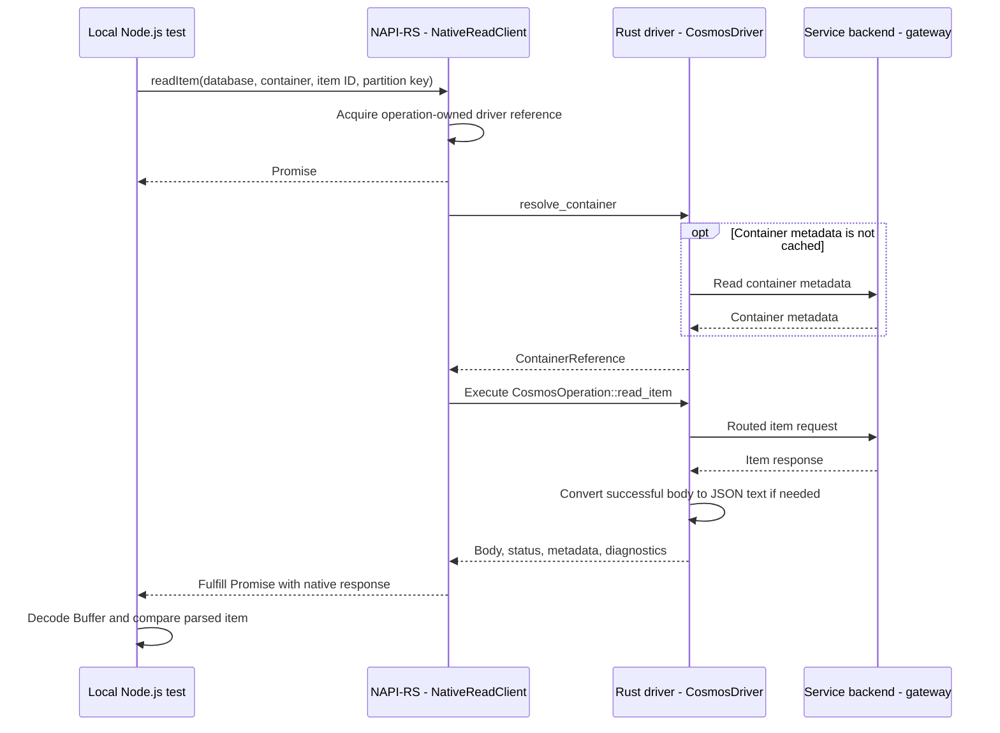

This diagram does not label the gateway request as Gateway V2: the actual
transport must come from the completed request's diagnostics.

### How do we exercise it without modifying existing data?

From `sdk\cosmosdb\cosmos`, with `ACCOUNT_HOST` and `ACCOUNT_KEY` already
available in the process environment:

```powershell
npm run build:rust-prototype
npm run test:rust-prototype
npm run test:rust-prototype:read
```

By default, the read check only reads the `sales/orders/order-17` target
with partition key `customer-17`. Missing credentials fail the test.
A missing target does not cause automatic resource creation or a silently
skipped success check.

The first live attempt returned 404 in both paths. Rust failed while
resolving `sales/orders`, before issuing the item read. That result alone
could not verify successful item conversion.

After explicit permission to create another database and container, the
check gained an opt-in **test fixture**: resources created solely for this
test. The fixture uses a uniquely named `rust-prototype-<UUID>` database,
an `orders` container with partition-key path `/customerId`, and the same
`order-17/customer-17` item with status `submitted`.

To authorize that setup for one run, start with the fixture variable unset:

```powershell
$env:COSMOS_RUST_PROTOTYPE_CREATE_TEST_FIXTURE = "1"
try {
    npm run test:rust-prototype:read
}
finally {
    Remove-Item Env:\COSMOS_RUST_PROTOTYPE_CREATE_TEST_FIXTURE
}
```

**This opt-in creates resources and can incur account charges.** It does not
request a custom throughput value. Setup uses ordinary creates, not
`createIfNotExists`, so a collision cannot adopt an existing database.
The test deletes only the database it successfully created, including its
container and item, in cleanup even when a read assertion fails.
The create and delete messages identify that database without printing
the account endpoint or key. Abrupt process termination can still require
manual cleanup of that named database.

### Reuse the retained JS/Rust prototype resources

For repeated development, we also created a dedicated database and container
with explicit permission and retained them rather than deleting them after
the check:

| Resource | Value |
|---|---|
| Database | `js_rust_read_item_db` |
| Container | `js_rust_read_item_container` |
| Partition-key path | `/customerId` |
| Item ID and partition-key value | `order-17` and `customer-17` |
| Item status | `submitted` |
| Container throughput | 400 RU/s |

These retained resources continue to incur account charges. The account
endpoint and key are supplied through the process environment; they are not
stored in this guide or in the test.

With `ACCOUNT_HOST` and `ACCOUNT_KEY` pointing to that account, leave
`COSMOS_RUST_PROTOTYPE_CREATE_TEST_FIXTURE` unset and select the existing
resources:

```powershell
$env:COSMOS_RUST_PROTOTYPE_DATABASE = "js_rust_read_item_db"
$env:COSMOS_RUST_PROTOTYPE_CONTAINER = "js_rust_read_item_container"
npm run test:rust-prototype:read
```

This mode reads the existing item without creating or deleting resources.
Unset target variables retain the original `sales/orders` defaults; empty
names fail before any operation is sent.

### What has this bite established?

The native build, seven existing local binding checks, and eleven
JavaScript read-selection regression checks passed. Rust formatting,
Clippy with warnings denied, and the scoped package checks passed.

The initial temporary live fixture established:

| Check | Executed outcome |
|---|---|
| Read the same item through legacy JavaScript and the native binding | Both returned 200; parsed bodies and item version markers matched |
| Preserve the original functional test's read assertions | Both returned the expected item ID and a numeric request charge |
| Read an absent item in the isolated container | Legacy fulfilled with 404/no resource; native rejected with 404 at `readItem` and retained its service response |
| Close immediately after accepting another read | The accepted operation completed; a new read rejected as closed |
| Remove temporary resources | The newly created database was deleted successfully |
| Require a successful Gateway V2 data read | **Failed** |

The successful native read retained exactly one diagnostic attempt:

```json
{
  "pipeline": "data_plane",
  "transport": "gateway",
  "statusCode": 200
}
```

Both total and retained attempt counts were 1. This is concrete evidence
of a **Gateway V1 data read**, not Gateway V2 and not missing diagnostics.
The Gateway V2 assertion failed on that run and was not weakened to
accept this result.

The inspected driver allows Gateway V2 by default but also depends on
service-advertised endpoints and its connectivity checks. The three
HTTP/2/Gateway V2 environment controls checked locally were unset.
That rules out those explicit environment opt-outs; it does not establish
which remaining condition prevented Gateway V2 on this account.

The retained-resource rerun on October 23, 2026 (UTC) also returned 200 through
both paths, with matching parsed bodies and item version markers. Its native
read again retained exactly one `data_plane / gateway / 200` attempt. Four
subtests passed; the Gateway V2 subtest and its parent failed. No retained
resources were deleted.

We then made a separate, read-only account-discovery request through the
JavaScript SDK, explicitly sending `x-ms-cosmos-use-thinclient: true` and
inspecting the response before the SDK converted it into `DatabaseAccount`.
The service backend returned 200 and one ordinary readable and writable
location, but omitted both `thinClientReadableLocations` and
`thinClientWritableLocations`. No Gateway V2 endpoint was therefore available
for that diagnostic's connectivity probe.

The pinned Rust revision already sends this discovery header. The separate
JavaScript request was evidence that discovery needed investigation, not
a capture of Rust's initialization response or proof of which service-backend
setting was responsible. Account enablement alone did not qualify the native
data read.

On October 24, 2026 (UTC), the same account advertised one thin-client readable
location and one thin-client writable location. The independent connectivity
probe negotiated HTTP/2 and returned 200. We then reran the existing native
read comparison against the retained resources without creating or deleting
anything.

Both legacy JavaScript and the native binding returned 200. Their parsed item
bodies and item version markers matched, and the original functional read
assertions passed. The native read retained exactly one request:

```json
{
  "pipeline": "data_plane",
  "transport": "gateway_v2",
  "statusCode": 200
}
```

The unchanged Gateway V2 assertion passed: there was no successful Gateway V1
fallback. All five subtests and their parent passed (six reported tests,
zero failures). The missing-item subtest is restricted to temporary-fixture
mode and was not exercised in this retained-resource run.

**The native item read now satisfies the Gateway V2 qualification gate.**
This is evidence for this account and operation, not a performance measurement
or a guarantee for every account. At the end of Bite 15, public `Item.read()`
still rejected Rust selection; Bite 16 below connects that path.
No complete response/error parity, cancellation support, sustained
workload, or performance improvement is claimed.

## Bite 16: How does the customer app receive the Rust read result?

**Bite 16 of approximately 24.**

### Start with the customer app

Alpha Bank should continue using the existing public API:

```typescript
const response = await client
  .database("js_rust_read_item_db")
  .container("js_rust_read_item_container")
  .item("order-17", "customer-17")
  .read();

console.log(response.resource.status); // "submitted"
console.log(response.requestCharge);
```

The customer app should not load the native binding, decode bytes, or learn
a different response format. The SDK now performs that work for the narrow
experimental read described below.

**The public `Item.read()` path is now connected to the native binding.**
The connection is opt-in and local to this prototype, not a production
native-package release.

### Why cannot we return the native result directly?

The two interfaces currently return different things:

| Native binding returns | Existing public API provides |
|---|---|
| `body`: bytes containing JSON | `resource`: the parsed JavaScript object |
| Separate request-charge, ETag, and activity-ID fields | `headers`, with getters such as `requestCharge` and `etag` |
| A compact list of native request attempts | The SDK's `CosmosDiagnostics` object |
| No public item reference | `response.item`: the original `Item` object |

We therefore need a **response adapter**: SDK code that translates the native
result into the existing `ItemResponse`.

This responsibility belongs in JavaScript because `ItemResponse` is the
JavaScript interface the customer app already uses. The Rust driver should
remain responsible for executing the operation, not constructing JavaScript
SDK classes.

### Follow our order back to the customer app

```text
Service backend returns order-17
    -> Rust driver completes the read
    -> binding returns body bytes and response metadata
    -> JavaScript adapter decodes and parses the body
    -> Item.read constructs the existing ItemResponse from the adapter result
    -> customer app receives response.resource.status
```

The adapter must preserve the actual metadata. For example,
`response.requestCharge` reads from `response.headers`; merely placing a
charge field on some other object would not preserve the existing behavior.

### A missing item needs deliberate handling

The current interfaces also differ for 404:

| Interface | Missing-item behavior |
|---|---|
| Native binding | Rejects the Promise with a structured error |
| Existing public `Item.read()` | Returns a response with `statusCode: 404` and `resource: undefined` |

Connecting them directly would unexpectedly make the customer app's `await`
throw. The adapter now converts a service-backed native 404 into the public
response while allowing other failures to propagate. A local driver failure
without a service response is not treated as a successful missing-item read.

### One important trap: diagnostics

The existing public-read wrapper replaces the returned object's
`diagnostics` with diagnostics collected by JavaScript.

If we simply attach the native diagnostics and return, that wrapper can
overwrite them. We must explicitly integrate the native evidence rather than
accidentally presenting an empty JavaScript request history as the Rust
read's diagnostics.

The adapter records native evidence on the operation's diagnostic node.
When the wrapper constructs the final `CosmosDiagnostics`, it carries that
evidence forward under the internal `experimentalRustRead` property. This
works for both successful responses and errors.

Its `coverage` is explicitly `"partial"`: the binding supplies request counts,
pipeline type, transport and status, not complete endpoint, timing, retry or
metadata histories. The existing JavaScript statistics are not a complete
measurement of the Rust driver. Empty JavaScript lists must not be interpreted
as proof that Rust performed no retries or metadata requests.

### Configure the local prototype

The SDK normally loads JavaScript modules. For this experiment it must also
load the compiled `.node` file produced in Bite 13. That file is still a local
build artifact, not a published dependency.

From `sdk\cosmosdb\cosmos`, after building the SDK and native binding, set:

```powershell
$env:AZURE_COSMOS_EXPERIMENTAL_READ_IMPLEMENTATION = "rust"
$env:AZURE_COSMOS_EXPERIMENTAL_NATIVE_BINDING_PATH = (
    Resolve-Path .\rust-prototype\cosmos_js_rust_prototype.node
).Path
```

The binding path must be absolute. The selected implementation and binding
path are captured when constructing the client; changing the environment
later does not switch that client's behavior.

The customer app can then construct its client with credentials already
available in the process environment:

```typescript
import { CosmosClient } from "@azure/cosmos";

const client = new CosmosClient({
  endpoint: process.env.ACCOUNT_HOST,
  key: process.env.ACCOUNT_KEY,
  connectionPolicy: { enableBackgroundEndpointRefreshing: false },
});

try {
  const response = await client
    .database("js_rust_read_item_db")
    .container("js_rust_read_item_container")
    .item("order-17", "customer-17")
    .read();
  console.log(response.statusCode);
  console.log(response.resource?.status);
} finally {
  client.dispose();
}
```

The first supported read loads and initializes one native client.
Concurrent reads share that initialization, and later reads reuse the same
native client. An initialization failure stays a failure for that client;
the SDK does not silently retry initialization or substitute a JavaScript read.
`dispose()` rejects new Rust reads but lets already accepted reads finish
before closing the native client, including reads accepted during initialization.

The native loader uses a user-approved, one-line lint exception for this
explicit local artifact. Browser and React Native loader variants reject
native reads without importing the Node loader. JavaScript-selected clients
do not load the `.node` file. Distribution and installation remain future work.

### Keep the first public read within its verified scope

This prototype supports existing, non-encrypted items addressed with one
explicit string partition-key value and account-key authentication. An
explicit empty string is permitted; an omitted, numeric or multi-component
partition key is rejected before native initialization.

Client configuration is deliberately restricted to endpoint/key or a parsed
connection string, diagnostic level, and an optional connection policy
containing only `enableBackgroundEndpointRefreshing: false`. Request options
must be empty. Custom headers, plugins, HTTP clients, credentials, encryption,
consistency, regions, retry settings, timeouts and cancellation are not silently
ignored; unsupported explicit configuration rejects the Rust read.

Other operations still use JavaScript. In particular, session state is not
shared between the two engines: do not use this milestone as proof of
read-after-write consistency following a JavaScript write on the same client.
The current workload reads an existing item.

The response adapter maps the fields available from the binding: body, status,
substatus, request charge, activity ID, ETag, session token and retry-after.
It validates successful JSON and request charge rather than returning a
success-shaped default. Other structured driver failures become `ErrorResponse`
objects with their original error retained as `cause`. Full header/error-body
parity and all failure categories have not been established.

The driver may still select Gateway V1 on other accounts. The live
qualification check requires actual Gateway V2 request evidence; the adapter
does not claim to disable the driver's transport fallback.

### What did we execute?

On October 25, 2026 (UTC), the public-read comparison used the retained
database and container without creating, replacing or deleting data. It ran
both the built CommonJS and ESM packages:

| Check | Executed outcome |
|---|---|
| Public JavaScript and Rust `Item.read()` | Both returned `ItemResponse`, status 200 and matching item content and ETags |
| Original functional read assertions | Expected item ID and numeric request charge passed on both paths |
| Public missing-item behavior | Both returned 404 with `resource: undefined`, rather than rejecting |
| Native transport through the public API | Gateway V2 evidence passed for both 200 and 404; no matching Gateway V1 fallback |
| Unsupported read inputs | Explicit request options and omitted partition key rejected |
| Dispose after accepting a read | Accepted read succeeded over Gateway V2; subsequent read rejected |

All eight subtests and both parent tests passed: ten reported tests, zero
failures. The original functional assertions were reused with read-only setup;
the destructive CRUD suite was not run.

The focused unit checks also cover concurrent initialization, response and
error conversion, malformed results, scope rejection, retained initialization
failure, and disposal during initialization. Source/test type-checking,
the all-target SDK build with API extraction, and scoped lint checks passed.

To repeat the live public comparison with credentials for the retained
prototype account already in the process environment:

```powershell
npm run test:rust-prototype:public-read
```

**The customer app can now receive a Rust-backed result through public
`Item.read()` within this restricted scope.** Complete compatibility,
production packaging and sustained performance qualification remain separate
work; this bite does not claim them.

## Prototype plan and reference

The sections below retain earlier design material, not a sequence already
implemented or reviewed. Bite 1 defines the active scope: local JS SDK
changes and a direct Node.js performance workload on a VM. Portal-related
sections below are deferred architecture context, not gates for this
experiment.

## Scope and selected approach

Prepare one experimental `container.item(id, partitionKey).read()` using the
Rust driver. Do not add a public JavaScript `read_item()` method.
The [foundations guide](foundations.md) teaches the TypeScript, Node.js,
and NAPI-RS concepts needed for this operation.
The [architecture guide](architecture.md) records the broader Portal
direction, outside the active local performance experiment.

**Node.js and NAPI-RS are selected. Gateway V2 is mandatory for the candidate's
data read.** Demonstrate and measure the operation in a Node.js workload
on the VM. Portal handler implementation and verification are deferred.
An addon echo, HTTP/2 alone, or successful Gateway V1 fallback is insufficient.
Rust execution inside the browser is outside this prototype.

**First implementation target:** a thin Rust adapter using NAPI-RS and
calling `azure_data_cosmos_driver` directly. Framework selection does not
establish correct runtime integration, supported packaging, or better latency.

The shared C-ABI wrapper remains a serious alternative, particularly if the
driver team requires a common native release boundary. Its current diagnostics
and credential coverage must be checked against this read's requirements.
Python's direct binding is prior art, not architectural approval.

**Performance rule:** measure first use, steady-state latency, scheduling,
and resources separately. A faster initialized JS SDK call does not prove
any application path outside the measured workload is faster. Bite 15 exercises
a native driver-backed read whose October 24 rerun met the required Gateway V2
gate. No executed performance workload or new
latency result is claimed by this document.

## Learning order and evidence

The implementation walkthrough now starts at **Bite 1 above**, with its own
numbering. The earlier Concepts 19-32 below retain their identifiers as
reference material; the [foundations guide](foundations.md) supplies language
and runtime explanations as needed. Later operations, publishing automation,
and full release qualification remain deferred. Saving a bite does not
establish that its implementation or measurements have run.

The illustrative customer is Alpha Bank; the example stays
`sales/orders`, `/customerId`, `customer-17`, `order-17`.
It uses an existing, non-encrypted item with a supplied string partition key.
Read setup can require account/container/routing metadata; those are supporting
requests, not permission to expand the public operation scope.

Reviewed local HEADs:

| Repository | Revision |
|---|---|
| JavaScript | `1f4635c260d8c2d87ab8796eb26d858dac0de7f5` |
| Rust | `075917d6cb987055dfa93e31296b261574456b66` |
| Python | `16d6f01bffc82dd17e755c3ff4e308e6199979c8` |

Statements about source refer to the inspected working trees, which can include
uncommitted changes. Record the patch, dependency locks, compiled artifacts,
and resolved package in an actual run. HEAD alone does not identify a binary.
Public framework/Explorer sources describe available code, not the deployed
Portal build or an executed experiment.

## Concept 19 of approximately 32: Trace the existing read

The customer waits for an `ItemResponse`, not just an HTTP response body.
The relevant source path is:

```text
CosmosClient -> Database -> Container -> Item
    -> Item.read()
    -> ClientContext.read()
    -> operation plugins
    -> RequestHandler.request() / JS retry handling
    -> request plugins / HTTP send
    -> response parsing / session capture
    -> ItemResponse and diagnostics
```

| File under `sdk\cosmosdb\cosmos\src` | Responsibility relevant to this read |
|---|---|
| `CosmosClient.ts` | Configuration, context, shared/background state, disposal |
| `client\Item\Item.ts` | Public read, missing-key handling, encryption branch, response shaping |
| `extractPartitionKey.ts` | Resolves an omitted key using the container's partition-key definition |
| `client\ClientUtils.ts` | Computes range ID when the applicable partition failover behavior is enabled |
| `ClientContext.ts` | Headers, session state, endpoint selection, operation plugins |
| `request\RequestHandler.ts` | Retry entry, request plugins, per-attempt abort/timeout, HTTP send, body parsing |
| `plugins\Plugin.ts` | Separate operation and request plugin stages |
| `client\Item\ItemResponse.ts`, `request\ResourceResponse.ts` | Resource, status, metadata getters, item reference |

Do not describe every supplied-key read as always performing a JS routing-map
lookup. `computePartitionKeyRangeId` is conditional.
Conversely, missing keys or configured encryption can add preparation work.

`Item.read` converts caught 404 errors into responses; other errors generally
propagate. The prototype must preserve JS response/error behavior, not assume
Python's missing-item behavior.
The `requestCharge` getter defaults missing/unparseable charge to zero, so
the benchmark must inspect the underlying header before accepting that zero
as service evidence.

Sources: [Item.ts](../../sdk/cosmosdb/cosmos/src/client/Item/Item.ts),
[ClientContext.ts](../../sdk/cosmosdb/cosmos/src/ClientContext.ts),
[RequestHandler.ts](../../sdk/cosmosdb/cosmos/src/request/RequestHandler.ts),
[ResourceResponse.ts](../../sdk/cosmosdb/cosmos/src/request/ResourceResponse.ts).

## Concept 20 of approximately 32: Choose where responsibility moves to Rust

Replacing only `httpRequest` would leave JS routing, sessions, and retries
around a Rust driver that also owns those responsibilities.
That is not the intended engine migration.

The proposed handoff is at the item-operation boundary, before entering the
legacy `ClientContext.read` execution path for the selected experimental read:

```text
Public Item.read()
    -> experimental scope validation / client initialization
    -> Rust operation adapter
    -> driver owns metadata, routing, sessions, retries, Gateway V2
    -> JS response/error/diagnostics adapter
    -> original ItemResponse contract
```

Keep the existing path unchanged by default. Select the experimental path
explicitly; the selection mechanism and its public/internal visibility need
review before implementation. Loading or execution failure must not invoke
the JS path invisibly.

| Responsibility | Proposed owner |
|---|---|
| Public JS types, options validation, `ItemResponse`, JS error compatibility | JavaScript adapter |
| Long-lived native state, input/result transfer, cancellation bridge | Rust binding |
| Metadata needed by Rust, endpoint/range routing, session state, retries, transport | Rust driver |
| Credential acquisition and required application routing policy | Existing application provider, connected through a supported driver contract |
| Browser-to-handler API, authorization, tenant isolation, and server deployment | Portal owner |

Request plugins are not cosmetic. A plugin can alter the destination for each
attempt, and authorization can depend on the request being signed.
Do not run a legacy plugin once and assume it represents all Rust retries.
The handoff remains blocked for required behaviors with no supported mapping.

**Mixed-engine session state is a prototype risk.** A JS write followed by a
Rust read can involve different session caches even on one `CosmosClient`.
For the initial read-only experiment, pre-seed the item outside the measurement,
use a dedicated client, and establish required explicit-session behavior.
Do not advertise automatic read-your-writes parity across migrated and
unmigrated operations until the state-transfer contract is implemented.
Moving only reads to Rust does not remove this risk: Explorer can still write
through JavaScript and then read through Rust. Before normal Explorer use,
verify the required session behavior across both engines, including switching
reads back to JavaScript. The restricted experiment above is not approval
for mixed-engine use.

## Concept 21 of approximately 32: Driver versus C ABI is a boundary decision

An **FFI**, or foreign-function interface, connects languages.
Both options below use inter-language machinery. The actual decision is
whether the Rust adapter calls typed Rust APIs or the common native C ABI:

```text
Direct: JS -> NAPI-RS binding -> Rust driver
C ABI:  JS -> native binding -> driver_native C ABI -> same Rust driver
```

Neither option should wrap the typed customer-facing `azure_data_cosmos` SDK
and serialize an application model twice.

| Factor | Direct driver adapter | Existing `azure_data_cosmos_driver_native` |
|---|---|---|
| Entry contract | Rust types compiled with the pinned driver | Flat C-compatible requests, operation handles, completion records |
| Async integration | Bridge a driver future to the host | Submit, drain completions, correlate user data, release results |
| Evolution cost | Rebuild/adapt with Rust API changes | Track ABI compatibility and packaged native library |
| Safety work | Host-value lifetime and Rust/JS callbacks | Those concerns plus C layouts, pointers, handle ownership |
| Reuse | Similar to the inspected Python binding | Common native boundary intended for multiple SDKs |
| Performance | Must measure complete read | Flat submission/results avoid assuming many per-field calls |

The native header exposes `cosmos_submit_singleton_operation`,
`cosmos_operation_handle_cancel`, and completion-queue operations.
Its completion record's `diagnostics` field is currently reserved/NULL.
The README also identifies resource-token support as follow-up.
These are concrete coverage gaps to resolve, not a claim that the wrapper
cannot perform any real read.

It has a host `TokenCredential` bridge. That is not automatically equivalent
to Explorer's `tokenProvider`, which can use verb/resource/path context and
modify date headers. Confirm the actual semantic mapping.

**Why direct for this prototype:** it fits a Rust-written Node adapter, gives
access to the driver's operation/diagnostic types, and avoids introducing a
completion-queue binding before validating the one operation.
This is a complexity judgment, not a measured latency result.

**When to choose the C ABI instead:** the owner requires a shared binary/release
contract, its required credential/diagnostic gaps are closed, and its Node
completion path meets the same correctness and performance gates.
The Rust project presents that wrapper as the cross-language integration
boundary; obtain owner agreement before turning the direct prototype into a
supported SDK architecture.

Sources: [layering ADR](../../../azure-sdk-for-rust/sdk/cosmos/docs/adrs/0001-sdk-driver-native-layering.md),
[flat ABI ADR](../../../azure-sdk-for-rust/sdk/cosmos/docs/adrs/0005-flat-native-abi-data-model.md),
[native header](../../../azure-sdk-for-rust/sdk/cosmos/azure_data_cosmos_driver_native/include/azurecosmosdriver.h),
[native README](../../../azure-sdk-for-rust/sdk/cosmos/azure_data_cosmos_driver_native/README.md),
[Python binding manifest](../../../azure-sdk-for-python/sdk/cosmos/azure-cosmos/azure_cosmos_rust/Cargo.toml).

## Concept 22 of approximately 32: Implement the selected NAPI-RS binding

The public read stays in TypeScript. Its implementation calls an internal
NAPI-RS export that connects the request to the Rust driver.
The addon must return completion, not merely confirmation that work was queued.

| Boundary | What the prototype must establish |
|---|---|
| TypeScript to native | Validated read arguments and owned snapshots of mutable inputs |
| Async execution | A supported executor arrangement, no blocking wait on Node.js's JavaScript thread |
| Native to TypeScript | Faithful body, status, headers, diagnostics, and error conversion |
| JavaScript credential callback | Correct context, lifetime, asynchronous completion, and failure propagation |
| Deployment | Pinned framework/features, supported targets, and packaged native artifact |

Use NAPI-RS-generated declarations for the internal bridge, not as an
automatic replacement for the public JS SDK types. Keep framework-specific
types inside the binding. Record versions, dependency locks, loaded artifacts,
and ownership for updates. NAPI-RS selection is not a performance result.

Source: [NAPI-RS async][napi-async].

## Concept 23 of approximately 32: Prove Gateway V2 from Node.js

The selected path is:

```text
Node.js JS SDK -> NAPI-RS addon -> Rust driver
    -> native HTTP client -> Cosmos Gateway V2 endpoint
```

**Gateway V2** is the driver's Cosmos request path, not a synonym for
HTTP/2. Its data read requires HTTP/2, but observing that protocol alone
does not prove the read used Gateway V2.

Build the pinned driver and addon, load them on the target Node.js host,
and read `order-17`. Correlate the binding entry, driver operation,
per-attempt transport evidence, and returned order. Keep framing, routing,
retries, and connection policy inside the driver.

Identify account discovery, metadata, and probes separately from the item
data attempt. A Gateway V1 data fallback makes the candidate run ineligible;
do not disable legitimate metadata requests to manufacture a V2 claim.
The browser-to-handler protocol is a separate connection and need not
match the driver's protocol.

Sources: [driver Cargo.toml](../../../azure-sdk-for-rust/sdk/cosmos/azure_data_cosmos_driver/Cargo.toml),
[HTTP factory](../../../azure-sdk-for-rust/sdk/cosmos/azure_data_cosmos_driver/src/driver/transport/http_client_factory.rs),
[transport ADR](../../../azure-sdk-for-rust/sdk/cosmos/docs/adrs/0006-internal-http-transport.md).

## Concept 24 of approximately 32: Separate the workload from Portal acceptance

The first workload is a Node.js program calling the JS SDK directly.
It does not need a Portal deployment to measure that boundary.
The later Portal flow adds a request handler:

```text
Explorer -> Node.js handler -> Rust-backed JS SDK -> Cosmos Gateway V2
```

The handler runs the operation, rather than simply forwarding an already
prepared Cosmos request. Before calling this a working Explorer integration,
resolve these questions with Portal:

| Question | Evidence needed |
|---|---|
| Which account and caller may the handler act for? | Required authorization modes and renewal/expiry tests |
| Can the browser contact the handler? | Actual Portal deployment with applicable CSP/CORS permissions |
| Can the server reach the account without breaking customer firewall intent? | Approved networking design and allow/deny tests |
| Are two customers' data and resources kept separate? | Defined tenant boundary and two-customer verification |
| Does the engineer see the order within the agreed budget? | Browser interaction timing including the added network hop |

These are service-integration gates, not prerequisites to an isolated
Node.js baseline workload. A passing workload is useful partial evidence,
not proof of authorization, tenant isolation, or Portal readiness.
The [architecture guide](architecture.md) owns those decisions.

## Concept 25 of approximately 32: Define the smallest honest boundary contract

The first implementation is an opt-in read-only slice, not SDK-wide parity.
Before writing it, map these categories to actual driver types:

| Lifetime | Required information |
|---|---|
| Client | Account endpoint, supported credential/provider, effective configuration, shared initialization and driver state |
| Read | Database/container identity, item ID, supplied string key, explicitly supported options, operation correlation, abort/deadline |
| Result | Service status/substatus, headers, supported body representation, operation diagnostics, defined binding failure |

The ordinary read has no item request body. Do not serialize a whole order
just to retrieve it.
Snapshot mutable arrays/headers before asynchronous execution. Do not convert
null/undefined/empty/false values into one generic "missing" case.

The public options surfaces are
[SharedOptions.ts](../../sdk/cosmosdb/cosmos/src/request/SharedOptions.ts) and
[RequestOptions.ts](../../sdk/cosmosdb/cosmos/src/request/RequestOptions.ts).
Use an explicit experimental allowlist with rejection, not silent dropping:

| Group | Initial handling requirement |
|---|---|
| `abortSignal`, explicit session token, required consistency | Implement and test before claiming the corresponding read behavior |
| `accessCondition` | Map supported conditions and 304/no-body behavior, or reject explicitly |
| Default/initial headers, priority, throughput bucket, excluded locations, cache controls | Map applicable required settings; reject unsupported non-default usage |
| Request plugins, `urlConnection`, custom HTTP client/agent | Do not pretend arbitrary legacy transport modification survives driver ownership |
| Encryption, omitted/non-string/hierarchical keys | Outside initial slice; explicit experimental-path rejection |
| Query/write-only options | Determine read applicability from current code, not merely membership in a shared interface |

Some Portal-required settings cannot be excluded just to obtain a benchmark.
If required routing/authentication cannot be mapped, Portal acceptance remains
blocked. A minimal Node test credential is only a development milestone.

For results, preserve `resource`, `statusCode`, `substatus`, real headers,
request charge, activity ID, ETag, diagnostics, and the `item` reference.
Do not fabricate JS retry stages for work executed by Rust.
If a diagnostic field has no faithful mapping, document and resolve it rather
than filling a success-looking placeholder.

## Concept 26 of approximately 32: Make lifetime and cancellation explicit

The proposed binding owns one reusable runtime/client state and one record per
in-flight read. Each record connects a JS Promise to its Rust task/result.

```text
admit -> snapshot inputs -> await shared initialization -> submit
      -> complete or cancel -> settle caller -> release operation state
```

Use one Rust executor arrangement, not an unexamined NAPI-RS runtime plus
another per-client Tokio runtime. Credentials requiring JS callbacks must
return to the correct JS context without blocking that context while waiting
for it. Otherwise initialization/authentication can deadlock.

Specify and test:

- A pre-aborted read does not submit data work.
- Cancellation while waiting for shared initialization detaches that read
  without cancelling other readers.
- Cancellation after submission reaches the driver task/handle and cleans up.
- Cancellation racing completion delivers one defined result and frees once.
- Disposal stops new admissions and has an explicit active-read policy.
- A failed initialization, Rust panic, worker failure, or missing artifact is
  observable and does not cause silent fallback.

The last point is not a promise that every native crash is recoverable;
the actual framework/build's panic and process-failure behavior needs testing.
With the C ABI, do not call blocking completion waits on Node's JS thread,
and copy/retain borrowed result fields before freeing their owner.

Current JS `requestTimeout` is enforced inside the HTTP attempt, after earlier
preparation. Do not label a new whole-operation timeout "unchanged parity."
Record the boundary and include remaining-time forwarding and cleanup in
the experiment's contract.

## Concept 27 of approximately 32: Build the intended SDK and artifacts

Read root `AGENTS.md` and the relevant package-workflow guidance before changing
the SDK package. Build from the JavaScript repository root:

```powershell
pnpm turbo build --filter=@azure/cosmos... --token 1
```

The trailing `...` includes dependencies. Do not substitute package-level
`npm run build`. Check the repository's declared tools before execution and
restore dependencies only when needed; this review did not install frameworks.

The inspected Cosmos package declares Node `>=22.0.0`, exports separate
browser/ESM/CommonJS files, and includes `dist` in its package.
The prototype must add its loader and native addon to the actual delivered
package rather than relying on a sibling build directory.

Before each experiment, establish:

| Check | Why it matters |
|---|---|
| Resolved `@azure/cosmos` entry and package version | Avoid measuring an installed release instead of this build |
| Rust source/lockfile/features and optimized build identity | Avoid stale or debug artifacts |
| Native platform/architecture and minimum Node-API level | Node ABI compatibility does not remove OS/CPU constraints |
| Node entry and loader resolution | The intended native addon loads without changing browser consumers |
| Packed-and-installed consumer | Workspace linking can hide missing package files |

No browser Rust artifact is required. Preserve the existing browser package
behavior for other consumers; the server-side addon must not leak into its
entry point. Test the Portal handler separately from native package loading.

Sources: [package.json](../../sdk/cosmosdb/cosmos/package.json),
[warp.config.yml](../../sdk/cosmosdb/cosmos/warp.config.yml),
[repository workflow](../../.github/skills/sdk-workflow/SKILL.md).

## Concept 28 of approximately 32: Implement in bounded, reversible steps

These are future implementation steps, not completed work:

1. **Establish the JS baseline.** Read the pre-existing order through the intended
   local SDK build. Capture success, 404, and authorization failure.
2. **Agree the native contract.** Pin NAPI-RS and the driver, establish runtime
   ownership, and confirm the supported V2 and credential path.
3. **Prove the binding.** Load it, transfer strings/bytes safely, return a Promise,
   surface deliberate errors, and verify Node.js responsiveness.
4. **Execute one real Rust read.** Reuse initialized state and prove V2 before
   integrating the public JS response path.
5. **Wire `Item.read`.** Add opt-in selection, supported-option validation,
   response/error/diagnostic mapping, and cancellation/disposal.
6. **Run the Node.js workload.** After correctness and path checks, compare
   existing and Rust-backed JS SDK reads on the same host.
7. **Integrate and measure the Portal path.** Add the handler, required
   authorization, networking, and isolation checks. Measure the browser
   interaction separately; no credential substitutions for acceptance.

Do not create a second SDK-shaped abstraction for every operation now.
One small read adapter and a clear ownership contract are enough.
Do not add query planning, QueryPlanInterop packaging, writes, batch, paging,
or release pipelines to make this milestone look more complete.

The account and item must be provided through an approved non-production
setup. The benchmark reads only; it does not create resources, change RU/s,
trigger failover, or embed keys in browser code.

## Concept 29 of approximately 32: Prove the read contract before timing it

**Parity** here means the agreed observable JS read behavior, not identical
internal implementation or every SDK feature.

| Case | Expected evidence |
|---|---|
| Existing order | Correct body/key/ID, 200, real metadata, actual V2 |
| Missing ID or wrong string key | Baseline-compatible 404 response and absent resource |
| Denied/expired credential | Correct status/substatus/error; renewal where required |
| Required session/consistency setting | Observable requirement preserved, not just argument accepted |
| Supported condition | Correct body/no-body and conditional status behavior |
| Unicode, empty strings, wrong argument types | Correct encoding or explicit validation; no coercion into another key |
| Unsupported option/encryption/key form | Explicit experimental limitation, no fallback |
| Concurrent reads | Correct caller/result association and independent snapshots |
| Abort/timeout/dispose races | Defined outcome, bounded cleanup, no duplicate settlement or hang |
| Missing native addon | Clear failure for the selected path |
| Portal handler | Actual account, caller authorization, customer separation, and V2 route verified |

Run offline adapter tests for conversion, mapping, and races first.
Use live-service evidence for V2, authorization, session behavior, and real
Portal routing. Mocks cannot prove those properties.
No tests or live results are implied by this matrix.

## Concept 30 of approximately 32: Prove the path, then freeze the baseline

Collect a separate evidence run with:

```text
Public read correlation
  -> selected binding entry
  -> driver operation
  -> data attempt TransportKind::GatewayV2
  -> expected result and completion
```

The driver diagnostics include per-attempt transport kind.
Expose or observe the actual record, not a constant "rust=true" label.
Correlate any proxy segment separately. Browser developer tools showing `h2`
are insufficient by themselves.

Then run clean timings using the same artifacts with verbose tracing disabled.
An intentionally unavailable selected artifact must fail the test, establishing
that a fallback did not supply the result.

Hold account, preferred region, item bytes, credential mode, consistency,
client reuse, supported options, caching, and load equal.
Record retries, throttling, network location, and machine/browser conditions.
Use JS and Rust calls against the same test endpoint and item where feasible.

The legacy JS baseline and Rust V2 candidate may use different protocols.
That is a **whole-implementation comparison**, not an isolated measurement of
Rust language speed. An optional Rust V1 control can help attribution but
cannot pass the mandatory V2 gate.

Sources: [driver transport diagnostics](../../../azure-sdk-for-rust/sdk/cosmos/azure_data_cosmos_driver/src/diagnostics/diagnostics_context.rs),
[Python read measurement guide](../../../azure-sdk-for-python/sdk/cosmos/azure-cosmos/docs/V5/profiling/02-read-item-measurements.md).

## Concept 31 of approximately 32: Run the sustained VM workload

Reuse the measurement boundaries from
[Python's read measurement guide](../../../azure-sdk-for-python/sdk/cosmos/azure-cosmos/docs/V5/profiling/02-read-item-measurements.md),
not its historic numbers or its workload implementation unchanged.
Python's broader drill covers many operations and release gates; this
experiment covers only point reads.

### Reuse the Python workload infrastructure

Start from the scripts in
`azure-sdk-for-python\sdk\cosmos\azure-cosmos\tests\workloads`, particularly
[`profiling_run_read_baseline.sh`](../../../azure-sdk-for-python/sdk/cosmos/azure-cosmos/tests/workloads/profiling_run_read_baseline.sh).
That launcher already provides a configurable-duration, rate-limited
comparison with profiling sessions, saved evidence, and result checks.
It currently launches `python3 workload.py` and accepts Python backend
selectors; it cannot run the JS SDK unchanged.

| Existing part | Plan for the JS prototype |
|---|---|
| VM setup, approved target, configuration, and session records | Reuse applicable infrastructure after checking Node.js/native build requirements; create separate JS experiment sessions |
| Duration, rate, in-flight limits, and repeated comparisons | Carry over the measurement model; adapt launch commands and implementation selectors |
| Python operation runner | Add a Node.js runner invoking the public JS `Item.read()` for both implementations |
| Saved measurements and reporting | Reuse compatible schemas and reporting after verifying units, timer boundaries, and implementation labels |
| Integrity and acceptance checks | Preserve completeness/error checks; review Python-specific assumptions and agree JS thresholds |

Reuse is the starting approach, not a claim that every helper is already
language-independent. Preserve the Python scripts and historical results;
identify the smallest compatible extension before editing them. Do not
run the Python SDK from Node.js and label that a JS SDK measurement.

**SDK-call latency** starts immediately before the public JS `read()` and ends
when its Promise settles, including binding/driver/result processing.
Use a monotonic clock such as `performance.now()`.
Record failed outcomes and durations separately from valid successful reads.

This fragment shows the timer boundary, not a complete benchmark:

```ts
const started = performance.now();
const response = await item.read();
const elapsedMs = performance.now() - started;
```

A fulfilled 404 is not a successful workload read of the pre-seeded order.
Validate status, identity, body, and required metadata before counting success.
Keep logging and file output outside the timed interval.
Validation after the timer still contributes to the workload's elapsed time.

### One workload, two JS SDK implementations

**Status: workload specification, not an implemented or executed runner.**
Build one Node.js workload that selects the existing or Rust-backed JS SDK
explicitly, then invokes the same `Item.read()` call. Selection belongs to
the experiment configuration, not an invented public JS SDK option.

| Workload input | Required value or rule |
|---|---|
| Target | Approved account, database `sales`, container `orders`, `order-17`, string partition key `customer-17` |
| Implementation | Explicit existing-JS or Rust-backed selection, with resolved package and binary identity |
| Authentication | Approved environment/provider configuration; never write credentials into results |
| Load | Declared duration, concurrency cap, and either closed-loop or scheduled-rate mode |
| Behavior | Matched consistency, timeouts, retries, region, client reuse, and supported options |
| Output | Unique run directory with manifest, samples/histograms, summary, errors, and completion record |

Before the run, prepare the known item separately. During the measured
workload, reuse one client and do not create resources or mutate the order.
Every fulfilled response must still be checked: a 404 or wrong order is
not a successful read. Capture rejected calls and unexpected responses,
including their durations, and make validation failures visible in the
run's exit status.

The runner should use a bounded admission loop, not create all future
Promises at once. Stop new admissions at the deadline, drain admitted
operations within a declared shutdown budget, and dispose the client.
Record unfinished operations and fail an incomplete run rather than omit
them. Timings, validation, and result writing are distinct stages; avoid
per-read console output distorting the comparison.

### First use and Portal timing are separate measurements

Record process launch, module loading, client construction, first read,
and later reads as separate boundaries. The first `.read()` can include
lazy initialization; it is not the whole process startup time.
Use an outer timer for process-launch-to-first-valid-order readiness.

Later, measure the complete Portal interaction:

```text
Engineer selects order -> browser sends handler request
    -> handler invokes JS SDK -> Rust read completes
    -> handler returns data -> Explorer displays order
```

Keep that result separate from the direct Node.js JS SDK-call measurements.
The proxy adds networking and handling work. Compare a handler using the
existing JS SDK with the same handler using the Rust-backed JS SDK if needed
to distinguish that cost. Start without SSR so rendering is not another
changing variable.

### Sustained comparison protocol

Run the existing and Rust-backed JS SDK workloads sequentially on the same
VM with comparable settings, without competing benchmark processes.
Choose and save duration, requested rate, in-flight limit, and repetitions
before execution. The Python launcher defaults to **480 seconds per
implementation**; this is a reference, not an approved JS duration or an
instruction to start a run now.

| Phase | Procedure |
|---|---|
| VM preparation | Verify installed JS SDK and native artifact, target access, available capacity, and a fresh experiment session |
| Correctness check | Return the expected order before beginning the sustained comparison |
| Sustained reads | Schedule reads at the agreed rate for the configured duration, with bounded in-flight work |
| Startup and later reads | Retain initial samples and report them separately from any explicitly defined steady-state window |
| Repetition | Repeat comparable runs in alternating implementation order; retain each run, including failed comparisons |
| Higher load | Increase only after baseline evidence is usable and test capacity is approved |
| Portal follow-up | Measure browser-to-handler-to-display timing after the direct Node.js comparison |

Stop admitting at the boundary, drain the admitted reads, and record actual
elapsed time through drain. Include all admitted outcomes.
Compute throughput from actual elapsed time, not just the admission duration.
Keep the Python exercise's distinction between requested arrivals and
completed work: record scheduled start, actual invocation, and completion.
If the in-flight cap delays a launch, preserve that wait and any unlaunched
work rather than silently reducing the requested rate.

A send-next-only-after-completion loop is a different workload: slow reads
reduce its offered load. It can be a smoke test, but must not replace the
scheduled-rate comparison without explicitly changing the experiment.

### Required output

| Category | Record |
|---|---|
| Identity | Run ID, environment, source/patch/build/lock hashes, resolved JS SDK, loaded native addon |
| Behavior | Actual backend/transport evidence, consistency/options, auth mode, region, cache state |
| Work | Admitted/completed/valid-success counts, unexpected fulfilled responses, rejected calls, drain duration |
| Latency | Raw samples or mergeable histogram, p50, p95, p99, maximum, failure durations |
| Service | Per-call charge/header presence, statuses/substatuses, retries, observed 429s |
| Node resources | Process CPU time, CPU per 1,000 valid reads, RSS, JS heap/external bytes, event-loop delay |
| Portal follow-up | Browser interaction latency, handler queue/processing time, failures, and time until order display |

**p50** is the median. **p99** is a latency at the 99th percentile, not the
slowest request. For sorted samples, a stated nearest-rank method uses
index `ceil(0.99 * N) - 1`.
Retain the sample count: 10,000 successes provide roughly 100 observations
in the slowest 1%, but even that is not a confidence guarantee.
If the run produces few samples, label p99 exploratory and extend
the run before a tail-latency decision. Do not report a credible p99.9 from
a tiny sample.

Compute throughput from valid successes divided by actual elapsed seconds.
Merge raw samples/histograms when a combined percentile is needed; averaging
window p99s is not a whole-run p99.
Retain per-run results so pooling does not conceal instability.

CPU time is processor work, not elapsed network waiting.
Node RSS includes more than the JS heap; native Rust allocations must
not disappear from the memory discussion. Missing measurements are
"not measured," not zero. Use profiler-attached runs separately.

Do not copy Python release thresholds, account capacity, or timeout assumptions
into the JS gate. Set numerical tolerances with the SDK/Portal owners before
interpreting a winner. Until then, report deltas and variability rather than
claiming acceptance.

The report should show the comparison without implying results already exist:

| Metric | Existing JS SDK | Rust-backed JS SDK |
|---|---|---|
| Valid reads / errors / unfinished work | Not measured | Not measured |
| JS SDK-call P50 / P95 / P99 / maximum | Not measured | Not measured |
| Successful reads/s and actual elapsed time | Not measured | Not measured |
| First-read and process-readiness durations | Not measured | Not measured |
| CPU, RSS, and event-loop delay | Not measured | Not measured |

Sources: [Node timing API][node-perf],
[Node process CPU/memory][node-process],
[Python read measurements](../../../azure-sdk-for-python/sdk/cosmos/azure-cosmos/docs/V5/profiling/02-read-item-measurements.md).

## Concept 32 of approximately 32: Decide what the evidence actually permits

A **non-functional requirement** describes how the operation must behave,
such as responsiveness, resource use, reliability, or deployment cost,
in addition to returning the right order.

| Gate | Acceptance evidence |
|---|---|
| Correctness | Agreed read matrix passes; unsupported scope is explicit |
| Required environments | Direct Node.js workload first; actual Portal handler path as a separate milestone |
| Gateway V2 | Completed candidate data reads use V2; no hidden V1/JS fallback |
| Tail latency and throughput | Repeated comparable p50/p99 and successful reads/s within agreed tolerances |
| CPU/memory | Work-normalized CPU, controlled retained state, responsive JS/page execution |
| Startup | Accounted native loading, client initialization, and first-use time within owner budgets |
| Reliability | Credential renewal, failures, cancellation, disposal, and missing-artifact behavior |
| Delivery/support | Required targets, reproducible artifacts, debug path, update/security ownership |

At this stage all execution/performance gates are **not run**.
Node.js and NAPI-RS are selected; the integration and workload still need
implementation. No browser Rust gate remains. Production readiness requires
the service-level networking, authorization, and isolation evidence too.

Use one of three conclusions after the experiment:

- **Eligible to expand:** the scoped read passes all required environments and
  agreed gates; later APIs still need their own review.
- **Useful partial evidence:** Node.js V2 results exist but Portal integration
  remains blocked. Do not call the migration complete.
- **Reject/rework candidate:** a required behavior, transport, policy, or
  performance gate fails.

The next implementation step is the scoped NAPI-RS read contract and its
Node.js workload, not another browser-framework comparison.

## External sources

The local source links above establish checkout behavior. External sources
below establish framework capabilities or public Explorer code, not a
specific deployed version. Pin their versions/revisions during implementation.

[napi-async]: https://napi.rs/docs/concepts/async-fn
[node-perf]: https://nodejs.org/api/perf_hooks.html
[node-process]: https://nodejs.org/api/process.html
